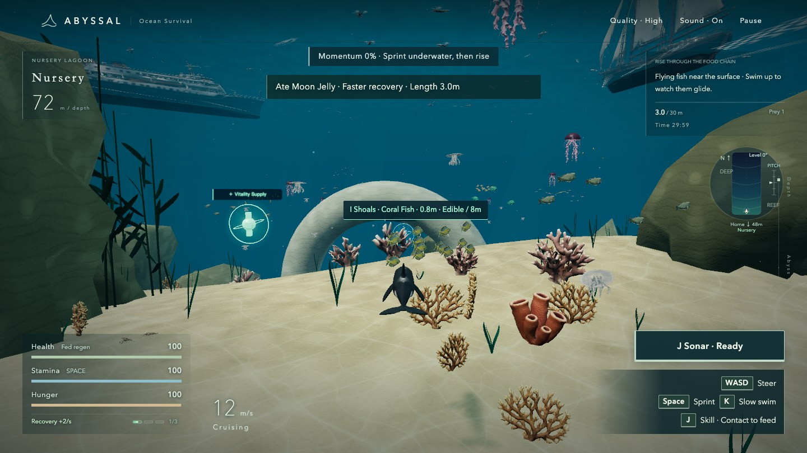
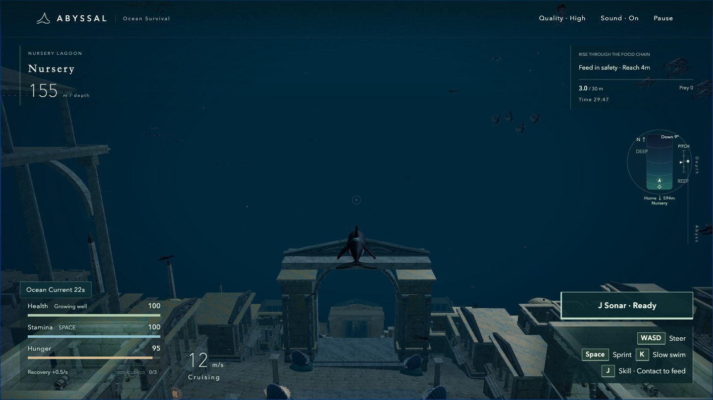
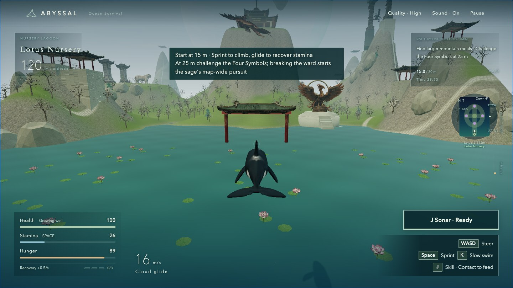

# ABYSSAL

**[Play now in your browser →](https://stanatny.github.io/abyssal/)** · No installation or account required

A single-player 3D survival and exploration game. Feed, grow, escape predators and challenge sea monsters across eight worlds, from sunlit reefs to alien oceans and mythic skies.

[](https://stanatny.github.io/abyssal/)

## Start playing

1. **[Open the game](https://stanatny.github.io/abyssal/)** in a modern browser with WebGL2 support.
2. Choose a character and destination, then select **Begin expedition**. Hawaiian Waters is a good first stop.
3. Eat smaller creatures, avoid larger hunters and follow the objective in the HUD. Open the **Ocean Guide** from the home screen to learn about creatures, abilities and landmarks.

Desktop keyboard and mobile touch controls are supported. Select English or Simplified Chinese on the home screen. Use **Smooth** graphics if your device needs a lighter rendering setting.

## Explore eight worlds

| Destination           | Your expedition                                                                                                          |
| --------------------- | ------------------------------------------------------------------------------------------------------------------------ |
| **Hawaiian Waters**   | Grow from a small juvenile among coral reefs, then challenge an Abyss Lord.                                              |
| **Ruins of Atlantis** | Find a hidden key, solve a randomly selected environmental puzzle, defeat the true guardian and open the treasure chest. |
| **Bermuda Triangle**  | Explore stormy waters and shipwrecks; defeat all four lords.                                                             |
| **Mariana Trench**    | Start at 15 m, defeat four ordered gatekeepers and reach the trench floor.                                               |
| **Amazon River**      | Hunt through rainforest channels and overcome three river lords.                                                         |
| **Europa**            | Explore an alien ocean beneath the ice and face three lords.                                                             |
| **Penglai Sanctuary** | Swim and fly through mythic landscapes; challenge the Four Symbols and Sword Sage.                                       |
| **Odyssean Sea**      | Explore a Greek-inspired mythic sea and defeat its three guardians.                                                      |

| Ruins of Atlantis                                                                                                                        | Penglai Sanctuary                                                                                                                                 |
| ---------------------------------------------------------------------------------------------------------------------------------------- | ------------------------------------------------------------------------------------------------------------------------------------------------- |
| [](https://stanatny.github.io/abyssal/) | [](https://stanatny.github.io/abyssal/) |

_Actual English gameplay screenshots from v0.11.28._

## Choose your character

- **Orca** — Use echolocation and fast sprints to hunt and explore.
- **Giant Squid** — Escape with ink and turn more sharply.
- **Zombie Shark** — Summon and command an undead companion.
- **Mechanical Shark** — Use armor and aimed homing torpedoes.

## Controls

Your character swims forward continuously. Contact with an eligible target automatically feeds or attacks; there is no bite key.

| Action               | Keyboard        | Touch          |
| -------------------- | --------------- | -------------- |
| Rise / dive and turn | W / S and A / D | Left joystick  |
| Sprint               | Hold Space      | Hold Sprint    |
| Slow swim            | Hold K          | Hold Slow swim |
| Active ability       | J               | Ability button |
| Pause / resume       | Esc or P        | Pause button   |

The mouse operates menus and the Guide. You can invert vertical controls in the expedition settings. Preferences and completion records stay in the current browser; an unfinished round is not saved.

## Run locally

Built with JavaScript, Three.js and Vite. Use Node.js 22.12 or newer.

```bash
git clone https://github.com/stanatny/abyssal.git
cd abyssal
npm ci
npm run dev
```

Open the local address printed by Vite. For checks and a production build:

```bash
npm test
npm run check
npm run build
```

## Project notes

- [Current release — v0.11.28](docs/release_v0_11_28.md)
- [Development rules](AGENTS.md) · [Asset quality standard](docs/asset_quality_standard.md)
- [Localization](docs/localization.md) · [Audio sources](docs/audio_sources.md) · [Verification records](docs/verification.md)
- [Earlier detailed README and development history](https://github.com/stanatny/abyssal/blob/ef6a6a2345329370d553a87d97389b869ac22cfe/README.md)

The worlds mix real animals, extinct species and fantasy creatures. Sizes and ecology serve the game rather than a scientific simulation.
