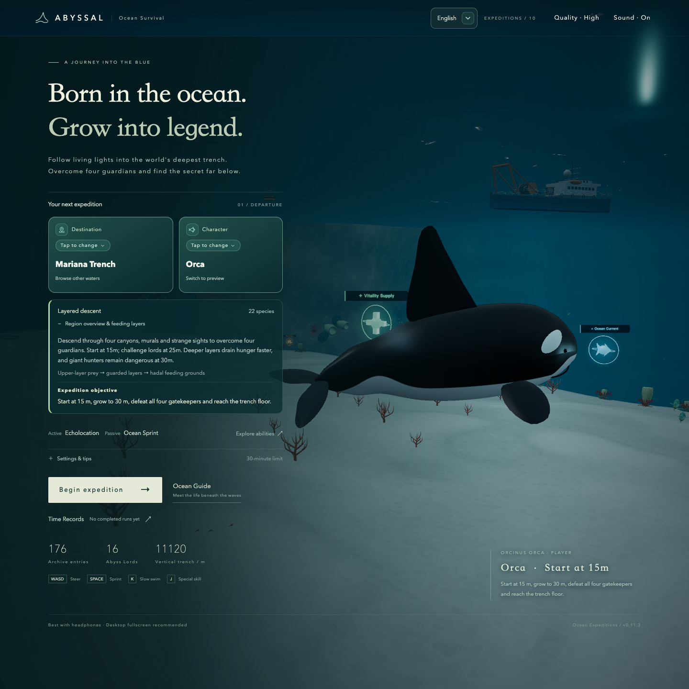

# ABYSSAL

Amazon and ordinary-predator main publication — 2026-10-26: the user accepts
the delivered charge repair and authorizes committing and pushing the completed
Amazon work to main as v0.11.19. Earlier candidate/no-push labels below are dated
history for this accepted scope. Runtime inputs match the delivered fingerprints
before release metadata edits. The next Europa redraw remains a separate task;
its existing creature descriptions and gameplay must be preserved. See
[the release record](docs/release_v0_11_19.md).

Ordinary predator charge candidate — 2026-10-26: accepted Amazon work is
committed locally as `b1dc929`. A separate correction bounds yellow-hunter flank
aim by existing mouth reach, includes still-dangerous yellow hunters in post-hit
rear-follow, and validates swept contact at its actual time/posed headings.
Original damage, timing, dodge, feeding and camera rules remain. This candidate
awaits player review; no commit/push. See [the charge review](docs/predator_charge_revision.md).

Amazon redraw accepted for local commit — 2026-10-26: the user authorizes
committing the completed Amazon batches and bank/water finish before a separate
large-predator charge investigation. Earlier candidate/no-commit labels below
are dated history for this scope. Delivered inputs remain byte-identical before
this status update; physical-phone performance is still unmeasured. This is a
local commit only, with no push or main publication authorized.

Amazon bank/water integration candidate — 2026-10-25: the user authorizes
riverbank/bed/island material finish and water/floating-scenery integration.
World-space sediment, a stable physical waterline and subtle instanced leaf
contacts preserve all terrain topology, 2,162 static and 13 floating contacts.
Previous models and gameplay remain. This appearance awaits review; no
commit/push. See [the integration record](docs/amazon_huggingface_redraw.md#bank-and-water-integration--2026-10-25).

Amazon batch 10 candidate — 2026-10-25: following the user's request for the
next group, two actual HF exports replace plain water pads with Victoria-inspired
leaves and separate cream/pink flowers. All 230 leaves remain; bounded local
spacing, waterline fitting, shared loading and spatial instancing are checked.
Previous monkeys and gameplay are preserved. This new appearance awaits review;
no commit/push. See [the batch record](docs/amazon_huggingface_redraw.md#batch-10-victoria-waterlilies--2026-10-25).

Amazon monkey motion reference follow-up — 2026-10-25: the user requests real
locomotion reference after the shoreline/pace revision. Source-reviewed Ateles
accounts and inspected captive footage now inform forward-facing suspended
hand transfers, coordinated torso/legs and tail balance. Six shoreline routes
remain, with only the two lowest supports raised for turning-body clearance.
This candidate awaits visual review; no commit/push. See
[the motion follow-up](docs/amazon_huggingface_redraw.md#monkey-motion-reference-follow-up--2026-10-25).

Amazon waterside-monkey follow-up — 2026-10-25: the user finds the first
monkeys too slow and too far inside the rainforest. All six routes now occupy
low, river-facing branches; travel and hand exchanges run 2.6 times faster.
Ordinary surface follow views, continuous grips and terrain clearance are
checked. This revision awaits visual review; no commit/push. See
[the follow-up](docs/amazon_huggingface_redraw.md#waterside-monkey-follow-up--2026-10-25).

Amazon batch 9 candidate — 2026-10-25: the user accepts batch 8 and requests
surface driftwood, a distinctive rainforest canopy and arboreal wildlife. Actual
HF kapok-inspired trees, acai palms and fitted spider monkeys now enrich the
river margins; 13 floating logs reuse accepted HF timber with moving contacts.
Tree roots are fitted to rendered land, and canopy LOD limits repeated detail.
All 1,779 tests pass; this new appearance awaits review, without commit/push.
See [the batch record](docs/amazon_huggingface_redraw.md#batch-9-rainforest-canopy-surface-timber-and-spider-monkeys--2026-10-25).

Amazon batch 8 candidate — 2026-10-25: the user accepts batch 7 and requests
the next scenery group. Two actual HF exports replace 56 riverbank roots and
30 island hanging roots while preserving all 2,162 contacts and prior content.
Bark relief, atlas fitting and shared loading/disposal are checked; this new
appearance awaits review, with no commit/push. See
[the batch record](docs/amazon_huggingface_redraw.md#batch-8-flooded-bank-roots-and-island-hanging-roots--2026-10-25).

Amazon batch 7 candidate — 2026-10-25: the user accepts batch 6 and requests
the next group. Actual HF exports replace Jade Arowana and riverbed driftwood.
The rare keeps its original rules; 112 instanced logs gain bark/splinter detail
and bounded terrain/rock fitting, with matching capsules and other colliders
unchanged. All 1,767 tests pass. The user accepts the shown appearances and requests the next scene batch; no commit/push.
See [the batch record](docs/amazon_huggingface_redraw.md#batch-7-jade-arowana-and-riverbed-driftwood--2026-10-25).

Amazon batch 6 candidate — 2026-10-25: the user accepts the four crocodilians
and authorizes the next group. Actual HF exports now replace Green Anaconda,
Titanoboa, Stupendemys and Flood Arapaima, with continuous serpent motion,
rigid-shell freshwater strokes and fitted fish fins. All 58 animals keep their
original gameplay. These four appearances await review; no commit/push. See
[the batch record](docs/amazon_huggingface_redraw.md#batch-6-serpents-stupendemys-and-flood-arapaima--2026-10-25).

Amazon batch 5 candidate — 2026-10-25: the user accepts the Electric Eel
discharge and requests the next group. Four actual HF exports replace Black
Caiman, Saltwater Crocodile, Purussaurus and Rootback Colossus, with fitted
tail-driven motion and trailing limbs. Twenty animals retain their original
gameplay; previous art and eel effects are preserved. All 1,754 tests pass.
These new appearances await review; no commit/push. See
[the batch record](docs/amazon_huggingface_redraw.md#batch-5-four-crocodilians--2026-10-25).

Electric Eel effect candidate — 2026-10-25: the user requests clearer discharge
feedback. Body charge arcs, a branching spatial release and a fading residual now
follow the actual hunter phases, preserving damage/range/cooldown, fitted swim
poses and shared colors. Pause/cancellation/reset/eviction are checked; no new
HF generation, commit or push. See [the effect record](docs/amazon_huggingface_redraw.md#electric-eel-discharge-follow-up--2026-10-25).

Amazon batch 4 candidate — 2026-10-25: the user accepts batch 3 and requests
the next group. Four actual HF exports replace Red Piranha, Electric Eel, River
Stingray and Amazon River Turtle, with separate fitted tail/ribbon/disc/foot
motion. Original stock, combat and eel discharge remain intact; near-camera
interior compatibility is preserved. This appearance awaits review, with no
commit/push. See [the batch record](docs/amazon_huggingface_redraw.md#batch-4-piranha-eel-ray-and-river-turtle--2026-10-25).

Amazon batch 3 candidate — 2026-10-25: the user accepts the preceding
small-fish/verified-charge work and authorizes the next batch. Actual HF exports
now replace Amazon Pacu, Silver Arowana, Arapaima and Redtail Catfish, with fitted
independent motion and the original 140 individuals/gameplay. The first Arowana
export is rejected for dorsal geometry defects; its replacement is reviewed in
color and clay. All 1,726 tests and native loading/recovery/ownership checks pass.
These four appearances await review; no commit/push. See
[the batch record](docs/amazon_huggingface_redraw.md#batch-3-larger-river-fish--2026-10-25).

Amazon batch 2 / verified charge — 2026-10-25: the user accepts Rootjaw's
terrain correction conditional on working attacks. A fresh contact repair now
registers its original 42-damage charge against the same solid player/lord
bodies, with sidestep and occlusion checks. Four actual HF small-fish candidates
replace Neon Tetra, Amazon Discus, Silver Hatchetfish and Armored Cory, keeping
148 individuals and original gameplay. The new appearances await review;
no commit/push. See [the batch record](docs/amazon_huggingface_redraw.md#batch-2-small-river-fish--2026-10-25).

Rootjaw terrain/pitch follow-up — 2026-10-25: the user flags a head entering
the riverbank in the preceding swimming video. Rootjaw now uses complete-body
terrain clearance and gradual dorsal-up pitch/turns, rather than centre-only
height correction. Ascent, descent and charge are checked in the actual river
scene; combat values and the other two lord rigs remain unchanged. This new
candidate awaits user review; no commit/push. See
[the terrain follow-up](docs/amazon_huggingface_redraw.md#rootjaw-terrain-and-pitch-follow-up--2026-10-25).

Rootjaw swimming follow-up — 2026-10-25: the user rejects the first HF
candidate's splayed, crawling-looking limbs. A new swimming-neutral HF export
preserves the root-armored crocodilian design, with backward-folded limbs and
tail-driven cruising/acceleration. The other two lord rigs and all gameplay
remain unchanged. This replacement awaits user review; no commit/push. See
[the follow-up evidence](docs/amazon_huggingface_redraw.md#rootjaw-swimming-follow-up--2026-10-25).

Amazon lord redraw candidate — 2026-10-25: three actual HF exports now replace
Thunderbarbel, Yacumama and Rootjaw, with fitted independent swim/attack poses.
Accepted players, twenty ordinary Amazon kinds and gameplay rules remain intact.
The current agent works alone on `art/amazon-hf-redraw`; this new appearance
awaits user review, with no commit/push. Work artifacts stay in the Developer
repository. See [the Amazon redraw record](docs/amazon_huggingface_redraw.md).

Mariana main publication — 2026-10-25: the user authorizes the accepted
regional redraw and loading wrap-up for main. Release v0.11.18 includes the
creatures, colonies, guardian geology, pit finishes, refuge and surface fleet.
All 1,475 delivered inputs match before release metadata edits. Earlier
candidate/no-push labels below are historical for this scope. The current agent
integrates alone, preserving services and historical worktrees. Phone performance
remains unmeasured. See [the release record](docs/release_v0_11_18.md).

Mariana loading wrap-up candidate — 2026-10-25: seven refuge textures now
prepare during the final descent instead of shallow entry. Initial refuge image
requests fall from seven to zero; appearance, 1,373 contacts and gameplay remain
exact. All 1,691 tests and native loading/recovery/disposal checks pass. This
reduces early preparation, without a measured phone-FPS or entry-time gain.
No commit/push; see [the loading record](docs/mariana_refuge_loading_revision.md).

Mariana resident acceptance / remaining review — 2026-10-25: the user accepts
all three residents. Main visual coverage is complete; small buoys, support
rocks and arch/apron finishing are optional. Native inspection confirms all
seven hidden-refuge color textures load early (1.85 MiB); depth-aware preparation
is the next useful experiment, not a measured phone-performance improvement.
Documentation only; no new generation, runtime edit, commit or push. See
[the remaining-scope review](docs/mariana_remaining_scope_review.md).

Mariana resident candidate — 2026-10-25: three actual HF exports replace the
bottom sponge, starfish and snail, with repaired surfaces and independent gentle
idle motion. Refuge contacts, other meshes, lights and rules remain unchanged.
All 1,685 tests and native loading/recovery/disposal checks pass. This appearance
awaits review; no commit/push. See [the resident record](docs/mariana_residents_huggingface_redraw.md).

Mariana surface-fleet candidate — 2026-10-24: the user accepts the refuge
and selects the two surface boats next. Actual HF research-vessel/tender exports
replace only their old renderers; 120 sampled poses, all 25 contacts and the three
buoys match the prior implementation. Full tests pass 1,683; normal loading,
online recovery and three disposal cycles pass. This appearance awaits review,
with no commit/push. See [the fleet record](docs/mariana_fleet_huggingface_redraw.md).

Mariana refuge candidate — 2026-10-24: the user authorizes the proposed four
buildings and plaza. Four actual HF exports now replace the old building shapes;
stone foundations and low terrace edges complete the warm street scene. Three
residents, lights and gameplay remain exact. Full tests pass 1,679; native
loading/recovery and three disposal cycles pass. This appearance awaits review;
no commit/push. See [the refuge record](docs/mariana_refuge_huggingface_redraw.md).

Mariana surface acceptance/review — 2026-10-24: the user accepts the pit-wall
and suspended-rock finish. Current source and native views identify the original
bottom refuge buildings/plaza as the next useful visual batch, with its residents
and minor rock supports following separately. These are proposals only; no game
code, new HF job, commit or push. See [the scope review](docs/mariana_rock_surfaces_huggingface_redraw.md#acceptance-and-remaining-scope-review--2026-10-24).

Mariana wall/rock surface candidate — 2026-10-24: the four guardian bays are
accepted. Two actual HF rock exports now supply color and geometric relief to
connecting pit walls and eight suspended platforms. All geometry, collision,
landmarks and routes remain exact; 1,680 tests and native recovery/disposal checks
pass. Four textures add 100,252 input bytes, without extra draw calls. This new
appearance awaits review; no commit/push. See [the surface record](docs/mariana_rock_surfaces_huggingface_redraw.md).

Mariana guardian geology candidate — 2026-10-24: the preceding small-fossil
batch is accepted. Four actual HF formations now distinguish the Hydra, Kraken,
Gran Maja and Leviathan side bays; rear apron sectors expand while 32 m routes,
gates and the warm bottom remain protected. All 82 Mariana tests and native
loading/recovery/ownership checks pass. This new appearance awaits user review;
no commit or push. See [the geology record](docs/mariana_layer_geology_huggingface_redraw.md).

Mariana fossil candidate — 2026-10-24: fresh included HF quota was verified
at 2400 seconds. A new actual export now replaces 35 small apron ornaments after
solid-surface repair; large landmarks, routes and rules remain intact. Thirteen
focused checks and native texture recovery/ownership checks pass. This new
appearance awaits review, without commit or push. The earlier no-export trial
below is historical; see [the completed candidate](docs/mariana_fossil_huggingface_redraw.md).

Mariana fossil trial — 2026-10-24: the user authorizes trying one new HF
asset despite limited included quota. A 512-resolution fossil relief is generated,
but only 117.84 seconds remain against the export's 120-second reservation.
The local budget check stops before export; no GLB or game integration exists,
and the preceding preview is unchanged. No paid excess, commit or push. See
[the trial record](docs/mariana_fossil_trial.md).

Mariana scenery candidate — 2026-10-24: batch 3 is accepted without
commit/push. Reused accepted HF branch/brain/fan prototypes now replace 56 shallow
colonies and 180 ledge fans; three cliff sites retreat 16 m while all terrain,
colliders and gameplay remain exact. No new HF quota is consumed. Full tests pass
1,671 and native texture recovery/lifecycle checks pass; this separate appearance
awaits review. See [the scenery record](docs/mariana_scenery_huggingface_redraw.md).

Mariana batch 3 candidate — 2026-10-24: batch 2 is accepted without
commit/push. Actual HF Shonisaurus and Glass Prawn now have fitted tail/flipper
and segmented-appendage rigs, with local prawn antenna/swimmeret repairs.
The final catalogue keeps 10 ancient reptiles and one rare; earlier accepted
assets and gameplay remain intact. Full tests pass 1,667; the new appearance
awaits user review. See [the Mariana record](docs/mariana_huggingface_redraw.md).

Mariana batch 2 candidate — 2026-10-24: the user accepts batch 1 and asks
for the next batch without commit/push. Actual HF Barreleye, Dragonfish and Mariana
Snailfish now use separate fitted rigs; Barreleye has a translucent head shield
and two real internal tubular eyes. The accepted first batch and other old assets
remain intact. 1,661 tests, native recovery/lifecycle and six production flows
pass; 445 public resources match. This new appearance awaits user review.
See [the Mariana record](docs/mariana_huggingface_redraw.md).

Mariana batch 1 candidate — 2026-10-24: live included HF quota permits three
new actual meshes: Moorish Idol, Lanternfish and Goblin Shark. Shared accepted
creatures, four guardians and all gameplay remain unchanged. The current agent
works alone on `art/mariana-hf-redraw`; this new appearance awaits review and is
not committed or pushed. Shonisaurus and the remaining regional creatures/scenery
stay in the later inventory. See the [Mariana review](docs/mariana_huggingface_redraw.md).

Bermuda main publication — 2026-10-24: the user authorizes a final remaining-work
review followed by commit and push to main. All 1,369 delivered input hashes
match. No new release-blocking defect is identified in the completed batches;
small vent fauna and broader seabed surface polish remain optional future work.
The accepted Bermuda creatures, fleet, wrecks, weather and natural formations
are included in v0.11.17. Earlier candidate/no-push labels below are historical
for this scope. The current agent integrates alone, retaining services and
historical worktrees. See the [release record](docs/release_v0_11_17.md).

Bermuda geology candidate — 2026-10-24: the user accepts the natural-seabed
batch and requests the next batch. Three actual HF prototypes now replace two
arches, 28 spires and 60 shelf rocks. Fitted solids preserve adult arch traversal;
the shallow arch and its marker move 65 m west off the old excavation cliff.
All other landmarks and non-geology solids remain exact. The new appearance
awaits review, with no commit/push. See the [geology review](docs/bermuda_geology_huggingface_redraw.md).

Bermuda natural-seabed candidate — 2026-10-24: the user accepts the cargo
wreck and requests the next batch. Reused accepted HF coral/fan/sponge assets
now cover both shallow and deep placement paths; twelve mineral chimneys use
one new actual TRELLIS.2 prototype. Slope seating, local fitted vent contacts
and bounded near/far detail preserve surrounding routes and rules. This new
appearance awaits review, without commit/push. Rocks, arches and small vent
fauna remain possible later work. See the [natural-scenery review](docs/bermuda_natural_scenery_huggingface_redraw.md).

Bermuda cargo-graveyard candidate — 2026-10-24: the user accepts the lost
aircraft and requests the next batch. An actual HF open-hull wreck and reused
cargo trunks replace the small procedural graveyard; fitted local contacts
and slope placement preserve its landmark and the surrounding terrain. The
new appearance awaits review, with no commit/push. Prior accepted work stays
intact. See the [cargo review](docs/bermuda_cargo_huggingface_redraw.md).

Bermuda lost-aircraft candidate — 2026-10-24: the user accepts the waterspout
and requests the next batch. An actual TRELLIS.2 twin-engine wreck replaces the
old aircraft; a nearby slope placement removes the old spire intersection and
updates only its fitted contact shapes. Other assets, terrain and rules remain
intact. The new candidate awaits visual review; no commit/push is requested.
See the [aircraft review](docs/bermuda_aircraft_huggingface_redraw.md).

Bermuda waterspout candidate — 2026-10-24: the user accepts the ghost ship
and requests the next batch. Condensation, spray and foam now replace the old
hard funnels, preserving all seven paths and hazard rules. Three TRELLIS.2 jobs
failed; the delivered effect uses its successful background-removal image output,
not a generated cloud mesh. The new weather appearance awaits review; prior
accepted work remains intact and uncommitted, with no push. See the
[waterspout review](docs/bermuda_waterspout_revision.md).

Bermuda ghost-ship candidate — 2026-10-23: the user accepts the wreck decay
pass and asks for the next batch. Two actual TRELLIS.2 assets replace the
Flying Dutchman-inspired hull and seven sails; existing captain/rigging and
all cannon/movement/collision rules are retained. This new appearance awaits
visual review, with no commit/push. Accepted liner work remains uncommitted;
waterspouts follow separately. See the [ghost-ship review](docs/bermuda_ghost_ship_huggingface_redraw.md).

Bermuda wreck decay follow-up — 2026-10-23: the user asks for visible corrosion,
broken structure and real holes. The existing HF surfaces now retain patchy rust;
the hull has torn openings and the upper walls have two collapsed sections.
Matching collision openings reduce 410 solids to 402; the four original routes,
11 rooms and 204 interior fixtures remain intact. Three unsupported windows are
removed (20 to 17 placements). This supersedes the earlier exact-collider claim
for the surface candidate below. No new HF job, commit or push is performed.
See the [surface review](docs/bermuda_liner_surfaces_huggingface_redraw.md#rust-and-open-breaches-follow-up--2026-10-23).

Bermuda liner surface candidate — 2026-10-23: three actual HF surface samples
now supply the existing hull, teak decks and bulkheads. Duplicate outer-wall
rendering is removed while all 410 colliders and exploration routes remain exact.
The new pass preserves preceding components/furnishings, adds six owned textures,
and remains uncommitted for visual review. No push/main publication is requested.
See the [surface review](docs/bermuda_liner_surfaces_huggingface_redraw.md).

Bermuda liner furnishings candidate — 2026-10-23: the user asks to continue.
Four actual HF assets replace 4 salon sofas, 4 passenger beds, 4 wardrobes and
10 trunks in the existing liner. Exact colliders, rooms and routes are retained;
the previous funnels/windows/boilers and all other assets are preserved. The
new candidate is uncommitted and pending visual review; no push/main publication
was requested. See the [furnishings review](docs/bermuda_liner_furnishings_huggingface_redraw.md).

Bermuda liner component candidate — 2026-10-23: the accepted offshore rig is
locally committed as `0ffd683`. Three actual HF assets now replace four funnels,
twenty promenade window panels and four steam boilers in the existing explorable
liner. Original colliders, rooms and routes remain exact; the hull and remaining
furnishings are not claimed complete. This separate candidate is uncommitted and
awaits visual review. See the [liner review](docs/bermuda_liner_components_huggingface_redraw.md).

Accepted Bermuda oil-rig checkpoint — 2026-10-23: the user accepts the delivered
HF rig and requests a local commit followed by the next batch. All 1,278
delivered inputs match before acceptance-only notes. The recorded 1,614 tests
and native/public evidence retain their original scope. Earlier pending labels
for this oil-rig batch are historical. No push or main publication is requested.
The explorable liner wreck follows as a separately reviewed candidate.

Bermuda oil-rig candidate — 2026-10-23: batch 3 is accepted and locally committed
as `5fb9c7f`. A separate HF topside redraw now replaces the offshore rig's
platform, drill tower, crane and quarters/helideck, preserving the ten original
collision solids and all fleet/gameplay rules. The new appearance is pending
user review and remains uncommitted/unpushed. See the [oil-rig review](docs/bermuda_oil_rig_huggingface_redraw.md).

Accepted Bermuda rare/fleet checkpoint — 2026-10-23: the user accepts Crimson
Sailfin, the Steel Cape freighter and storm tanker, and requests a local commit
followed by the next HF batch. All 1,270 delivered input hashes match before
these acceptance-only notes. Recorded 1,611 tests and native/public evidence
retain their original scope. Earlier pending labels for this batch are historical.
No push/main publication is requested; regional landmark work follows separately.

Bermuda rare/fleet candidates — 2026-10-23: accepted predator and Cameroceras
motion work is locally committed as `d454e7b`. The next HF batch replaces Crimson
Sailfin and the two regional freighter/tanker skins, preserving routes, colliders,
rare rules and accepted shared assets. The new batch awaits visual acceptance and
remains uncommitted/unpushed. Oil rig, liner wreck, ghost ship and waterspouts
remain separate future batches. See the [rare/fleet review](docs/bermuda_rare_fleet_huggingface_redraw.md).

Accepted Bermuda predator checkpoint — 2026-10-23: the user accepts Tiger
Shark, Cameroceras and Livyatan, including the researched Cameroceras motion
follow-up, and requests a local commit followed by the next HF batch. All 1,256
delivered input hashes match before these acceptance-only notes. The recorded
1,606 tests and native/public evidence retain their original scope. Earlier
pending labels below are historical for this accepted batch only. No push or
main publication is requested; remaining regional content follows in separately
reviewed batches.

Cameroceras motion follow-up — 2026-10-23: the user authorizes applying the
researched orthocone posture. The current agent independently adds apex-up
low-travel posture, apex-first transit and arm-crown hunting orientation, with
posed bite direction. Existing routes/speeds and other creatures stay unchanged;
soft anatomy and the selected poses remain explicit artistic reconstruction.
This supersedes the prior arms-first motion candidate only, with no commit/push.
See [the motion review](docs/bermuda_predators_huggingface_redraw.md#cameroceras-motion-follow-up--2026-10-23).

Bermuda predator candidates — 2026-10-23: accepted batch 1 is locally
committed as `95713f5`. The current agent independently redraws Tiger Shark,
Cameroceras and Livyatan with actual HF TRELLIS.2 meshes, preserving regional
stock, dimensions, gameplay and accepted shared assets. These three new models
remain uncommitted/unpushed for user review. Formal main/Pages stays v0.11.16.
Oil rigs, the explorable liner wreck, waterspouts and the Flying Dutchman-inspired
ghost ship are explicitly queued after creatures. See the
[predator review](docs/bermuda_predators_huggingface_redraw.md).

Accepted Bermuda batch 1 checkpoint — 2026-10-23: the user accepts the four
HF fish and requests a local commit, then the next batch. All 1,243 delivered
input hashes match before these acceptance-only notes; the recorded 1,594 tests
and native/public evidence retain their original scope. Earlier pending labels
below are historical for batch 1. No push or main publication is requested.
After the remaining creatures, redraw Bermuda-specific oil rigs, the explorable
ocean-liner wreck (Titanic references), waterspouts and the Flying Dutchman-inspired
ghost ship in separate reviewed batches, preserving their exploration/combat rules.
See [the Bermuda inventory](docs/bermuda_huggingface_redraw.md).

Bermuda batch 1 candidate — 2026-10-23: the current agent independently redraws
Queen Angelfish, Gray Triggerfish, Atlantic Needlefish and Great Barracuda with
actual Hugging Face TRELLIS.2 meshes. Already accepted shared creatures,
characters/lords and gameplay are retained. Great Barracuda also receives a
matching offline camera-interior proxy. The candidate is uncommitted/unpushed
on `art/bermuda-hf-redraw`, based on `0dcb05f`; formal Pages stays v0.11.16.
The user has not visually accepted this batch. See the
[Bermuda inventory and review](docs/bermuda_huggingface_redraw.md).

Release v0.11.16 — 2026-10-23: publish the accepted Atlantis redraw and
combat/rendering work through `8f27834`, plus loading checkpoint `3c28a7d`,
on main after v0.11.15 / `3aef21e`. This release preserves the restored stable
follow camera and excludes the rejected fade, moving-camera and far-LOD trials.
See [the release record](docs/release_v0_11_16.md) for scope and verification
limits. New work returns to the default review-before-commit rule.

Main publication authorized — 2026-10-23: the user accepts the delivered loading
optimization and explicitly requests committing and pushing to main. All 1,229
reviewed inputs match before acceptance/release metadata edits. Integrate the
accepted Atlantis branch and loading work together; earlier candidate-only and
no-push labels below are historical for this scope. The current agent integrates
alone, preserving services and archives. Physical-phone PP-Q055 remains open;
loading acceptance does not establish phone FPS, heat or full incident recovery.

Region loading candidate — 2026-10-23: the user authorizes optimization after
accepted checkpoint `8f27834`. The current agent defers unselected environment
factories, fixes final-byte gzip generation and provides explicit failed-module
recovery. The distant-detail trial is rejected for lack of repeatable frame/GPU
gain; accepted city assets, gameplay and rendering remain unchanged. This new
candidate is uncommitted/unpushed; physical-phone PP-Q055 stays open. See the
[loading review](docs/region_environment_loading_revision.md).

Accepted neighborhood checkpoint — 2026-10-23: the user accepts the delivered
courtyard entrances, villa gables, market friezes and tower crowns and requests a
local commit plus a read-only priority review. All 1,226 delivered inputs match
before these acceptance-only notes; the recorded 1,582 tests and native/public
checks retain their original scope. The pending labels below are historical for
this accepted batch. No push or main publication is requested. The original
physical-phone report remains open; acceptance does not establish phone
performance parity. See the [neighborhood review](docs/atlantis_neighborhood_huggingface_redraw.md).

Atlantis neighborhood candidates — 2026-10-23: after accepted checkpoint
`f7fc33b`, the current agent independently uses four actual HF components for
courtyard entrances, villa gables, market friezes and tower crowns. Existing
layouts, openings, ordered colliders and gameplay remain intact. Close review
rejects the first overly simplified conversion; the new candidate preserves more
carving detail and remains uncommitted/unpushed for user review. See the
[neighborhood review](docs/atlantis_neighborhood_huggingface_redraw.md).

Accepted quest-prop and furnishing checkpoint — 2026-10-22: the user requests
“提交吧，还有什么没完成的”, accepting the delivered key aura and four HF
furnishings together with the previously accepted mechanisms/quest skins.
All 1,213 delivered inputs match before these acceptance-only notes. The recorded
1,579 tests and native/public checks retain their original scope. This authorizes
a local commit only; earlier pending labels below are historical for these two
batches. The read-only follow-up inventory is in
[the remaining-content audit](docs/atlantis_remaining_content_20261022.md).

Atlantis furnishings and key glow candidate — 2026-10-22: the user accepts the
previous waterlock housings, inscriptions and quest chest, asks for a luminous
key and authorizes the next HF batch. Four household skins (bench, table,
decorative storage chest and amphora) use shared instanced assets while keeping
original placements/colliders. The key receives a bounded soft aura. These new
changes await visual acceptance and remain uncommitted/unpushed. The earlier
quest-prop pending label below is historical for the three accepted items.
See [the furnishing review](docs/atlantis_furniture_huggingface_redraw.md).

Atlantis quest-prop candidate — 2026-10-22: following the accepted contact/
trailing commit `1aef4c0`, the user authorizes the next HF batch. The current agent
independently replaces the conch waterlock housings, key, three inscriptions and
quest-chest skin. Original sites, collection centers, warning/damage timing,
reward and accepted city/creature/camera work remain intact. The new candidate
awaits visual review and is uncommitted/unpushed. See [the quest-prop review](docs/atlantis_quest_huggingface_redraw.md).

Accepted body-contact and trailing checkpoint — 2026-10-22: the user accepts
the delivered ordinary large-body collision and post-bite rear-follow candidate
and requests a local commit. Delivered source hashes match before these
acceptance notes; the recorded 1,572 tests and native/public checks retain their
original scope. Earlier pending labels for this candidate are historical. No push
or main release is requested. The next task is a read-only Atlantis gap audit,
not authorization to redesign already accepted content.

Post-bite trailing follow-up — 2026-10-22: the user requests that a hunter
remain behind after landing a bite, preparing the next attack rather than sliding
past the player. Ordinary large swimming hunters now aim for a rear waiting
point, brake on approach, and close again near the existing bite cooldown end.
A successful strike starts this behavior; sprint escape, world constraints and
the stable camera remain intact. This supplements the uncommitted contact
candidate, not a new commit or release. See [the contact review](docs/ordinary_body_contact_revision.md#post-bite-trailing-follow-up--2026-10-22).

Ordinary large-body contact candidate — 2026-10-22: accepted silhouette and
interior display is locally committed as `2f66234`, without push. A new report
confirms that ordinary hunters have bite checks but no continuous trunk
separation. The current agent independently adds player/large-creature body
contact, preserving the stable follow camera, edible prey, damage and lord rules.
This new candidate awaits review and remains uncommitted. See
[the contact review](docs/ordinary_body_contact_revision.md).

Accepted visual checkpoint — 2026-10-22: the user accepts the player outline
and general large-pursuer interior fill and requests a local commit. All 1,183
delivered input hashes match before acceptance-only notes. The recorded 1,563
tests and native/public evidence retain their original scope. Earlier pending
labels below are historical for this checkpoint. A new report of creature bodies
passing through one another is a separate collision investigation, not proof
that the render-only fill provides physical solidity. Preserve the stable follow
camera; no push or main publication is requested.

Large-pursuer interior candidate — 2026-10-22: the user accepts the player
outline and requests a general hollow-body correction. The current agent
independently adds camera-near body sections across the predator/large-creature
census, including all 18 lords; the stable follow camera, opaque source skins and
gameplay remain intact. Very close bodies still obscure terrain. The new fill
awaits visual review and remains uncommitted/unpushed. See [the review](docs/creature_interior_revision.md).

Player-silhouette candidate — 2026-10-22: the preceding Kraken motion/pressure
and restored follow camera are locally committed as `04d16a2`, without push.
The current agent independently adds an occluded-player silhouette, preserving
the exact follow camera, opaque creatures, existing assets and gameplay. This
new effect awaits user visual review and remains uncommitted. It helps locate
the player; it does not reveal terrain behind a giant creature or solve clipping.
See [the silhouette review](docs/player_silhouette_revision.md).

Local checkpoint accepted — 2026-10-22: the user requests committing the
current version, then reviewing a player-silhouette effect. This accepts the
Kraken motion/pressure work with the original follow camera restored, not the
rejected moving-camera/fading experiments. Previous verification retains its
recorded scope. This authorizes a local commit only. The next silhouette candidate
must preserve camera behavior, opaque creatures and gameplay and remain
uncommitted until separately accepted.

Stable follow camera restored — 2026-10-22: the user rejects the moving-camera
candidate because its repeated corrections disrupt control. Restore the exact
pre-experiment follow-camera functions and ordinary creature factory; retain
world-wall collision and all pending Kraken changes. Both experimental camera
avoidance and foreground fading are removed. Original close-body clipping is an
explicitly accepted temporary trade-off, not a solved defect. Research supports
player silhouettes and off-screen threat cues as future options, not a new
implementation in this change. No commit/push. See [the rollback review](docs/kraken_motion_camera_revision.md#stable-follow-camera-restoration--2026-10-22).

Pursuer-camera rework — 2026-10-22: the user rejects the foreground fade,
including counterflow creatures disappearing behind the player. Remove the
material/shader mask entirely. The new candidate shortens the follow arm and
uses a bounded rear-shoulder/height correction around nearby visible geometry,
then eases back. Creature appearance, movement and the pending Kraken changes
remain intact. User/physical-phone review is pending; no commit or push.
See [the replacement review](docs/kraken_motion_camera_revision.md#opaque-pursuer-camera-rework--2026-10-22).

Kraken pressure follow-up — 2026-10-22: the user requests eight-arm reaching,
a distance-priced sprint escape (up to 120 stamina), and a clear forward view
when a giant pursuer crowds the lens. This supersedes the earlier unchanged-
gameplay and physical-camera-avoidance candidate below. The current agent alone
adds a bounded capture pose and render-only foreground occlusion relief. Native
100/150-stamina cases and 1,559 tests pass; user review remains pending. No new
commit/push, service replacement or formal release. See the [follow-up review](docs/kraken_motion_camera_revision.md#pressure-and-forward-view-follow-up--2026-10-22).

Kraken/camera candidate — 2026-10-22: the preceding rendering and performance
checkpoint is locally committed as `8e974d7`, without push. The current agent
independently adds state-driven Kraken arm motion and follow-camera avoidance
of visible large pursuers, keeping gameplay and source assets unchanged.
See [the implementation and evidence](docs/kraken_motion_camera_revision.md).
This new candidate remains uncommitted for user review. The original physical-
phone black-screen incident retains its earlier verification limits.

Accepted rendering checkpoint — 2026-10-22: the user requests committing the
current performance and graphics-recovery candidate, then separately improving
Kraken motion and camera clipping through large pursuers. All 1,167 delivered
input hashes match before these acceptance-only notes. The recorded 1,552-test
and native/public evidence keeps its original scope; the original physical-phone
stall and complete black-surface incident remain unconfirmed on this host.
This authorizes a local checkpoint only, without push or main publication.
The following pending labels are historical for this checkpoint. New Kraken and
camera changes require separate review and remain uncommitted by default.

Graphics recovery candidate — 2026-10-22: the user reports dark, detail-free
surfaces on a physical phone after a gate-entry stall and Continue. Forced context
loss confirms missing regenerated environment pixels; repair recreates active
lighting, retires stale renderer resources and blocks Continue until a first
restored frame is ready. See [the recovery review](docs/graphics_context_recovery.md).
The complete phone failure and original stall trigger remain unverified on this
host; preserve the preceding performance candidate and do not claim acceptance.
No new commit/push or formal release.

Atlantis preparation optimization candidate — 2026-10-22: accepted civic/material
work is locally committed as `5c70e44`. The current agent independently reduces
redundant furniture collision queries, packed-byte decoding allocations and
mismatched HDR shader precompilation. Appearance and gameplay remain unchanged.
See [the measured review](docs/atlantis_runtime_optimization.md); host preparation
improvements do not establish physical-phone FPS or thermal gains. This new
candidate remains uncommitted/unpushed for review.

Accepted Atlantis city checkpoint — 2026-10-22: the user says “可以先提交一版，
看起来还不错”, accepting the civic components and material/wall-stability follow-up.
All 1,160 delivered inputs match before these acceptance-only notes. The recorded
1,544-test/native/public results retain their original scope. This authorizes a
local commit, without push or main publication. The current agent independently
investigates and optimizes reported phone stutter and loading delay, preserving
the accepted visual quality and gameplay. New performance changes require a new
review; older pending labels below are historical for the accepted city batch.

Atlantis material follow-up — 2026-10-22: the user requests a coherent royal-city
and underground surface upgrade and reports flickering temple walls. The current
agent adds shared limestone/marble materials, clips duplicate Poseidon masonry
skins and smooths existing lamp-source transitions, preserving collision/layout
and accepted assets. All 1,544 tests and native route/cache/recovery checks pass;
visual acceptance remains pending. The preceding civic batch stays uncommitted.
See [the material review](docs/atlantis_material_revision.md).

Atlantis civic-component candidates — 2026-10-21: accepted Poseidon/obelisks
are locally committed as `3072def`, without push. The current agent independently
rebuilds the colonnades, marine-relief pediments and arch stones of two temples,
six pavilions and four gateways using three actual HF meshes. Original layout,
colliders, accepted models and gameplay remain unchanged. All 1,541 tests pass;
new candidates await visual review. See [the civic review](docs/atlantis_civic_huggingface_redraw.md).

Accepted Atlantis monuments checkpoint — 2026-10-21: the user says
“提交吧，亚特兰蒂斯古城，其他海底建筑也想办法重绘一下吧”, accepting
Poseidon and the six inscribed obelisks and authorizing a local commit. All
1,143 delivered inputs match before these acceptance-only notes; prior 1,538-test
and native/public receipts retain their original scope. The current agent
continues independently with other unredrawn city architecture through HF,
preserving openings, interiors, grown-body routes and accepted assets. No push
or main publication is requested; the next candidates require visual review.

Atlantis monument candidates — 2026-10-21: accepted boats/Pelican are locally
committed as `fc19861`, without push. The current agent independently adds actual
HF Poseidon and six obelisk visuals, preserving all city collision/placement/
landmark/light contracts and accepted assets. All 1,538 tests and native load,
retry, disposal, grown-route and bilingual preview checks pass. New monuments
await user visual acceptance; no new commit or publication. See
[the monument review](docs/atlantis_monuments_huggingface_redraw.md).

Accepted Atlantis surface checkpoint — 2026-10-21: the user says
“提交，下一批”, authorizing a local commit of the three night boats and the
missed Brown Pelican replacement. All 1,134 delivered inputs match before these
acceptance-only notes; the recorded 1,533-test/native/public results retain their
original scope. The current agent continues independently with a bounded
unredrawn scenery batch. No push/main publication is requested; new candidates
require visual review. Earlier pending labels below are historical.

Atlantis surface-inventory correction — 2026-10-21: the user identifies the
still-procedural Brown Pelican and requests the next batch. The current agent
alone adds its actual HF replacement for the shared Atlantis/Bermuda Guide and
world path. The earlier 20-kind count covered underwater ecology, not surface
birds. Preserve all accepted assets and the preceding uncommitted night boats;
no commit/push or formal publication. See [the Pelican review](docs/atlantis_pelican_huggingface_redraw.md).

Atlantis third HF batch — 2026-10-21: the user-accepted second creature batch
and Spadefish repair are locally committed as `1b58a90`, without push. The current
agent alone replaces the three remaining regional night boats through actual
HF inference, preserving routes, dimensions, collision/impact and accepted
assets. See [the fleet review](docs/atlantis_fleet_huggingface_redraw.md).
These new boats await visual review; no new commit or formal publication.

Accepted Atlantis second-batch checkpoint — 2026-10-21: the user says
“提交吧，下一批”, accepting Spadefish (including its swimming follow-up),
Seahorse, Cuttlefish and Pearl Nautilus and authorizing their local commit.
All 1,116 delivered inputs match before these acceptance-only notes. The
recorded 1,525-test/native/public checks retain their original evidence scope.
The current agent continues independently with the next unredrawn Atlantis
batch. No push/main publication is requested; new candidates require review.

Spadefish swimming follow-up — 2026-10-21: the user rejects the second-batch
motion. The current agent repairs pelvic/chest weight leakage and coordinates
rear-body, tail and soft-fin motion, preserving the HF surface, gameplay and
other species. Earlier tests do not imply visual acceptance. See the
[follow-up](docs/atlantis_creatures_huggingface_redraw.md#spadefish-swimming-follow-up--2026-10-21).
This remains uncommitted for review; keep other candidates and services intact.

Atlantis second HF batch — 2026-10-21: accepted first-batch assets are locally
committed as `267d4d0`. The current AI agent alone adds Spadefish, Seahorse,
Cuttlefish and the regional Pearl Nautilus candidates. Preserve all accepted
models, gameplay and existing services. This new batch awaits individual visual
review, without commit/push or formal publication. See
[the batch review](docs/atlantis_creatures_huggingface_redraw.md#batch-2-spadefish-seahorse-cuttlefish-and-pearl-nautilus--2026-10-21).

Accepted Atlantis first-batch checkpoint — 2026-10-21: the user says “可以，提交吧，下一批”, accepting Blue Shark, Swordfish, Helicoprion and Ichthyosaur and authorizing their local commit. All 1,103 delivered input hashes match before these acceptance notes. Recorded 1,513-test/native/public evidence retains its unchanged-input scope; no new test run is implied. The current AI agent continues independently with Spadefish, Seahorse, Cuttlefish and Pearl Nautilus. Preserve accepted assets, gameplay and services. New candidates require user review; no push or formal release is requested.

Atlantis first HF batch — 2026-10-21: the user requests bounded redraw batches
and excludes already improved creatures/scenery. The current AI agent alone
adds Blue Shark, Swordfish, Helicoprion and Ichthyosaur candidates on
`art/atlantis-hf-redraw`, based on main `3aef21e` / v0.11.15. Shared accepted
Hawaii creatures, Kraken, players, Atlantis layout and gameplay are preserved.
See [the batch review](docs/atlantis_creatures_huggingface_redraw.md). These four
candidates await individual user review; no commit/push or formal release.

Mechanical Shark belly-rack release — 2026-10-21: the user accepts and authorizes [v0.11.15](docs/release_v0_11_15.md) for main. One visible hanging torpedo fires from the actual mount and replenishes within the existing cooldown; the mouth remains dedicated to feeding. Exact-main CI and Pages verification are recorded separately from the accepted preview.

Hawaii retrospective — 2026-10-21: [lessons and rejected approaches](docs/hawaii_redraw_retrospective.md), with focused integration guidance in the repository Creature Polish and Map Production Skills. This follow-up changes documentation only; runtime remains the released v0.11.14.

Main publication authorized — 2026-10-21: the user requests committing and
pushing the accepted changes to main. This supersedes the earlier local-only
and pending labels for the accumulated Hawaii redraws, selected combat/lord
audio, loading cache and CPU optimization. All 1,078 delivered input hashes
match before release-only metadata edits. The current AI agent integrates
alone; preserve gameplay, services and historical worktrees. Release v0.11.14
follows v0.11.13 / `110494c`; no tag or GitHub Release is requested. See the
[release record](docs/release_v0_11_14.md). Future changes return to the default
authorization rule.

## Historical development checkpoints

Runtime CPU candidate — 2026-10-21: after accepted checkpoint `87095f5`, the
current agent independently reuses deterministic Amazon/Odyssey rest bounds
and removes grid-range intermediate arrays. Exact collision rules, models,
quality and gameplay remain unchanged. Armored Cory retains uncached bounds
because its existing factory mutates its shared armor surface. Fresh 1,498
tests and serial baseline/candidate measurements are recorded in
[the CPU review](docs/runtime_cpu_optimization_revision.md). Warm switches
improve on this host; no physical-phone, M4 thermal or general FPS gain is
claimed. This candidate is uncommitted, with no push or formal release.

All current preview changes accepted — 2026-10-21: the user confirms that all
current effects have passed review and authorizes committing them together.
This includes Contact Mine, the four reef decorations, Sunfish/turtle refinements,
selected combat/lord audio and versioned loading cache. This supersedes earlier
pending and cache-only checkpoint labels for these delivered changes. Preserve
gameplay and existing services. No push or main/Pages publication is requested.
The current AI agent next audits runtime CPU/GPU costs independently.

Accepted loading-cache checkpoint — 2026-10-21: the user approves a local
commit of versioned model chunks, compressed transfer and restricted HTTP
caching. Browser restart and same-address replacement are verified; preceding
measurements belong to the combined preview, with independent commit checks
recorded separately. See [the review](docs/runtime_loading_cache_revision.md).
Other pending art/audio changes remain separate. No push or Pages release.

Current loading-cache candidate — 2026-10-20: content-hashed model chunks,
precompressed JavaScript/CSS and browser HTTP caching shorten repeated preview
loads while fresh HTML selects updated assets. All model/audio/gameplay source
files are preserved. Native browser restart, update, old-tab, rollback and
cache-disabled checks pass; this is not a physical-phone measurement. See
[the loading review](docs/runtime_loading_cache_revision.md). No commit/push.

Accepted lord-attack audio — 2026-10-20: the user approves applying the delivered
first version. All18 lord kinds /22 ability combinations retain14 MOSS-generated
release cues, including Hydra breath, White Tiger roar and Sword Sage blades/rush.
Existing warnings, selected feeding/hurt/bite sounds and gameplay are preserved.
The accepted version is active in the restricted preview and remains uncommitted;
see [the review](docs/lord_attack_audio_revision.md).

Current selected combat-audio candidate — 2026-10-20: ordinary Stable B and
three MOSS B feedback cues are integrated and technically verified; final
game-mix listening awaits user review. [Integration and evidence](docs/combat_audio_huggingface_audition.md#user-selection-and-runtime-integration--2026-10-20).
No commit, push or formal release.

Hawaii visual refinement — 2026-10-20: the current AI agent independently audits remaining visual elements, narrows Sunfish lateral thickness and refines Green Sea Turtle/Archelon power-stroke and recovery motion. Preserve gameplay, accepted Octopus, pending reef/Mine work and services. Fresh tests and real-NPC evidence are in [the review](docs/hawaii_sunfish_turtle_revision.md). This candidate awaits user review; no commit/push or formal release.

Local Octopus checkpoint authorization — 2026-10-20: the user says “你先按照这个提交吧”, authorizing a local checkpoint of the current volumetric swimming repair. Preserve the open-rest/quiet-transit/compact-fast poses, unchanged gameplay and the recorded20 focused/1,460 full checks. This supersedes earlier pending/no-commit labels only for Octopus. Reef PP-Q042 and Contact Mine PP-Q039 remain separate uncommitted candidates. No push, version bump or main/Pages release is authorized. See [the review](docs/octopus_swimming_revision.md#local-checkpoint-authorization--2026-10-20).

Volumetric Octopus bundle — 2026-10-20: the user rejects the preceding flattened fan. The current AI agent alone preserves arm/cup sections around the travel axis with offline full/halfway poses, retaining open rest, actual-travel blending and gameplay. Fresh20 focused /1,460 full tests and real-NPC/visual/resource checks pass; this new candidate awaits user review, without commit/push. Preserve pending reef/Mine work. See [the repair](docs/octopus_swimming_revision.md#volumetric-arm-bundle-repair--2026-10-20).

Natural-jet Octopus follow-up — 2026-10-20: the user rejects the previous swimming animation as artificial. After inspecting NOAA transit footage, the current AI agent alone replaces synchronized arm rowing with a compact three-dimensional trailing envelope, brief mantle contraction and quiet asynchronous tip drift. Stationary arms relax; existing movement/ink rules and the pending reef/Mine candidates remain intact. This new candidate awaits user visual review, without commit/push. See [the motion review](docs/octopus_swimming_revision.md#reference-footage-and-natural-jet-follow-up--2026-10-20).

Current Octopus swimming candidate — 2026-10-20: the current AI agent alone replaces the radial display pose with an actual HF swim-ready surface, mantle-first travel, eight distinct arm supports, a relaxed stationary spread, trailing swimming waves and coordinated effort/ink poses. Preserve all gameplay and other species; the pending reef and Contact Mine candidates remain intact. Fresh targeted, real-world ink/pause, shared-asset and lifecycle checks are documented in [the swimming review](docs/octopus_swimming_revision.md). This candidate awaits user review, with no commit/push or formal release; HEAD remains `5cea32f`, main/Pages v0.11.13.

Current Hawaii reef-decoration candidate — 2026-10-20: accepted seabed landmarks are locally committed as `5cea32f`. The current AI agent alone completes four actual HF reef forms: branching coral, sea fan, brain coral and tube sponge. Preserve seeded colony anchors, terrain, collisions and gameplay; use clustered instancing and near/far geometry. Fresh 1,450-test, material lifecycle, populated native and 70-resource production checks pass, including normal-entry color loading. See [the production review](docs/hawaii_reef_life_huggingface_redraw.md). The reef batch and separate Contact Mine remain uncommitted for user review; no push/main release. Formal main/Pages remains v0.11.13.

Accepted local seabed-landmark checkpoint — 2026-10-20: the user says “提交吧，下一批”, accepting the delivered Wreck Remains, Whale Fall, Sunken Step Temple and Abyss Rift Gate and authorizing their local commit. All1,017 delivered source inputs still match; recorded1,445-test/native/public receipts retain their unchanged-input scope. Preserve the separate Contact Mine candidate. The current AI agent independently continues a bounded reef-decoration batch; new candidates require user review. No push/main release is requested; formal main/Pages remains v0.11.13.

Current Hawaii seabed landmark candidate — 2026-10-20: accepted surface ships are locally committed as `96bcac6`. The current AI agent alone has completed four actual HF landmark candidates: Wreck Remains, Whale Fall, Sunken Step Temple and Abyss Rift Gate. Preserve the exact positions/collision contract, old large gate passage, other assets and gameplay. Fresh1,445-test, native/lifecycle and66-resource public checks pass; user visual acceptance remains pending. See [the production review](docs/hawaii_landmarks_huggingface_redraw.md). New landmarks and the separate Contact Mine remain uncommitted/unpushed; formal main/Pages remains v0.11.13.

Accepted local surface-fleet checkpoint — 2026-10-20: the user says “提交吧，下一批”, accepting the three delivered HF surface ships and authorizing a local commit. All1,003 delivered source inputs match before these acceptance notes; recorded1,441-test/native/public receipts keep their unchanged-input scope. Preserve the separate uncommitted Contact Mine candidate. The current AI agent independently continues the four remaining Hawaii seabed landmarks, preserving gameplay and services. No push/main publication is authorized; formal main/Pages remains v0.11.13. See [the fleet review](docs/hawaii_surface_ships_huggingface_redraw.md).

Current Hawaii surface-fleet candidate — 2026-10-20: the current AI agent alone continues the user-authorized three surface ships through actual Hugging Face exports. Preserve 64/29/21m lengths, 1.8m draft, routes, collision/impact rules, existing wakes and accepted assets. See [the fleet review](docs/hawaii_surface_ships_huggingface_redraw.md). These three candidates remain uncommitted/unpushed for individual review; preserve the preceding Contact Mine candidate, services, archives and formal main/Pages v0.11.13.

Current Contact Mine candidate — 2026-10-20: accepted submarine/torpedo/ochre work is locally committed as `891e494`, without push. The current AI agent alone redraws the spherical Contact Mine through actual HF inference, preserving static placement, exact diameter, warning semantics and contact explosion rules. See [the production review](docs/contact_mine_huggingface_redraw.md). This new candidate remains uncommitted/unpushed for individual review; preserve accepted creatures, services, archives and formal main/Pages v0.11.13.

Accepted local vehicle checkpoint — 2026-10-20: the user requests “提交，下一批”, authorizing a local commit of the submarine, its straight-running torpedo and the ochre palette follow-up, then the Contact Mine redraw. All986 source inputs and58 runtime artifacts match the reviewed delivery before these acceptance notes. Prior checks retain their actual scope; no push/main release is requested. The current AI agent works alone; the next mine candidate requires separate visual acceptance and commit authorization. Preserve gameplay, services, archives and formal main/Pages v0.11.13.

Submarine palette follow-up — 2026-10-20: use restrained ochre hull coloring to distinguish the vehicle in deep water, preserving its source texture, geometry, rotor and combat. The attack torpedo stays unchanged; the spherical Contact Mine remains queued and is prioritized next. See [the follow-up](docs/hawaii_vehicle_huggingface_redraw.md#submarine-palette-follow-up--2026-10-20). No new HF inference, commit or push; user review remains pending.

Current Hawaii vehicle candidate — 2026-10-20: after local checkpoint `962da2a`, the current AI agent alone redraws the deep-sea submarine and its attack torpedo through actual Hugging Face inference. Shared rigid bodies, independent rotors and fitted launch effects preserve the existing defense/ram rules. See [the production review](docs/hawaii_vehicle_huggingface_redraw.md). Both candidates await user review; no new commit/push. Preserve accepted creatures, services, archives and formal main/Pages v0.11.13.

Accepted local Hawaii creature checkpoint — 2026-10-20: the user says “现在可以了，提交吧”, accepting the latest Swimmer repair and authorizing a local checkpoint of the delivered batches10–11 plus appearance-loading/human corrections. All976 source fingerprints and56 build artifacts match the final delivery before these acceptance notes; fresh1,433-test and native/public receipts retain their actual scope. No push/main publication is requested. Next, audit all remaining Hawaii elements, including the Torpedo Submarine; the existing creature queue did not claim vehicles or scenery were redrawn. Preserve gameplay, services and archives; the current AI agent works alone.

Current Swimmer coordination repair — 2026-10-20: the user rejects the latest recovery pose again. The current AI agent alone corrects overlapping arm timing, anatomical elbow rotation, body roll and misplaced Swimmer ankle pivots. See [the review](docs/appearance_loading_human_revision.md#swimmer-coordination-and-ankle-pivots--2026-10-20). Keep accepted colors/loading status, Diver motion, other assets and gameplay unchanged; no commit/push and visual review remains pending.

Current Swimmer/loading follow-up — 2026-10-20: the user confirms restored colors but rejects folded Swimmer recovery and the bright loading-status box. The current AI agent alone replaces the hand path and streamlines the kick, and corrects theme-aware loading status. See [the follow-up](docs/appearance_loading_human_revision.md#swimmer-recovery-and-loading-contrast-follow-up--2026-10-20). Preserve the accepted texture recovery, models, Diver motion, gameplay, services and archives. This remains uncommitted for review.

Current appearance/human repair — 2026-10-20: the user rejects eleventh-batch shoulder spheres and Diver posture and reports missing colors across generated creatures. The current AI agent alone repairs continuous human skinning and motion plus whole-roster recoverable texture loading. See [the repair record](docs/appearance_loading_human_revision.md). This is an uncommitted candidate; preserve batches10–11, accepted gameplay, services, archives and formal main/Pages v0.11.13. Earlier technical passes do not imply visual acceptance.

Current eleventh Hawaii batch — 2026-10-19: the user explicitly adds seabirds and people. The current AI agent alone completes Gilded Manta, Gull, White-tailed Tropicbird and both adult Swimmer/Diver variants: seven candidate meshes across five kinds. The expanded non-lord queue is33 kinds /35 appearances; all now have candidates or prior checkpoints. Batches10–11 remain uncommitted for individual review; HEAD0eafb80 and formal main/Pages v0.11.13 stay unchanged. Preserve gameplay, services and archives. See [the current review](docs/hawaii_creatures_huggingface_redraw.md#eleventh-batch-gilded-manta-seabirds-and-adult-people--2026-10-19).

Current tenth Hawaii batch — 2026-10-19: the user-authorized batches7–9/Tuna checkpoint is locally committed as `0eafb80`. The current AI agent alone adds Herring, Anchovy, Moon Jelly and Spiny Lobster HF candidates, bringing the non-lord queue to28 of31 (3 remaining). This new batch stays uncommitted for individual review; preserve gameplay, services, archives and formal main v0.11.13. See [the current review](docs/hawaii_creatures_huggingface_redraw.md#tenth-batch-herring-anchovy-moon-jelly-and-spiny-lobster--2026-10-19). Earlier entries retain their historical scope.

Accepted local twelve-creature checkpoint — 2026-10-19: the user requests “好的，做一个提交，继续下一组吧”, authorizing a local checkpoint of batches7–9 and the Tuna UV correction before Herring, Anchovy, Moon Jelly and Spiny Lobster. All939 delivered source fingerprints and45 build artifacts match before these acceptance notes. Existing1,405-test/native/public receipts retain their recorded scope. No push/main release. The current AI agent works alone; new candidates remain uncommitted for individual review. Preserve gameplay, services and archives.

Current Tuna atlas correction — 2026-10-19: the user reports smeared pale patches on the Bluefin Tuna back. The current AI agent independently rebuilds its UV atlas and transfers the original HF surface colors offline, retaining all3,774 body triangles, rig and gameplay. See [the correction review](docs/hawaii_creatures_huggingface_redraw.md#tuna-uv-atlas-follow-up--2026-10-19). Batches7–9 remain uncommitted for individual review; HEAD4715a62 and formal main v0.11.13 stay unchanged.

Current ninth Hawaii batch — 2026-10-19: the current AI agent alone adds Flying Fish, Reef Fish, Pacific Mackerel and Pacific Sardine HF candidates, bringing the non-lord queue to24 of31 (7 remaining). Batches7–9 remain uncommitted for individual review; HEAD4715a62, gameplay, services, archives and formal main v0.11.13 remain intact. See [the current review](docs/hawaii_creatures_huggingface_redraw.md#ninth-batch-flying-fish-reef-fish-mackerel-and-sardine--2026-10-19). Earlier entries retain their historical scope.

Current eighth Hawaii batch — 2026-10-19: the current AI agent alone adds Angler, Wrasse, Parrotfish and Boxfish HF candidates, bringing the non-lord queue to20 of31 (11 remaining). These and the seventh-batch candidates remain uncommitted for individual review; HEAD4715a62, gameplay, services, archives and formal main v0.11.13 remain intact. See [the current review](docs/hawaii_creatures_huggingface_redraw.md#eighth-batch-angler-wrasse-parrotfish-and-boxfish--2026-10-19). Earlier entries retain their historical scope.

Current seventh Hawaii batch — 2026-10-19: the accepted Archelon/Green Sea Turtle checkpoint is locally committed as `4715a62`. The current AI agent alone adds Ray, Sunfish, Tuna and Octopus HF candidates for review, bringing the non-lord queue to16 of31 (15 remaining). New work stays uncommitted/unpushed; gameplay, services, archives and formal main v0.11.13 remain intact. See [the current review](docs/hawaii_creatures_huggingface_redraw.md#seventh-batch-ray-sunfish-tuna-and-octopus--2026-10-19). Earlier entries retain their historical scope.

Accepted local turtle checkpoint — 2026-10-19: the user requests “提交，下一批，我觉得你可以效率高一点，一次多做几个给我审核吧”, authorizing a local commit of Archelon/Green Sea Turtle, then a larger four-kind batch: Ray, Ocean Sunfish, Tuna and Octopus. All902 delivered source fingerprints and33 artifacts match before these acceptance notes. Earlier1,375-test/native/public receipts retain their recorded scope; no push/main release. The current AI agent works alone. New candidates stay uncommitted for review; preserve gameplay, services and archives.

Current sixth Hawaii pair — 2026-10-19: Plesiosaur, Dunkleosteus and the head-armor follow-up are locally committed as `e705d6d`. The current AI agent independently completes Archelon and Green Sea Turtle using actual HF meshes and included Pro quota. Twelve of31 non-lord kinds now have redraws;19 remain, next Ray and Ocean Sunfish. These two new candidates remain uncommitted/unpushed for individual review. Preserve gameplay, services, archives and formal main v0.11.13. See [the current review](docs/hawaii_creatures_huggingface_redraw.md#sixth-pair-archelon-and-green-sea-turtle--2026-10-19).

Accepted local fifth-pair checkpoint — 2026-10-19: the user requests “提交吧，下一批”, authorizing a local commit of Plesiosaur, Dunkleosteus and the clearer head-armor palette, then continuation with Archelon and Green Sea Turtle. All894 delivered source fingerprints and31 artifacts match before acceptance-note edits. Existing test/native/public receipts retain their recorded scope. No push/main release. The current AI agent works alone; subsequent candidates stay uncommitted for individual review. Preserve gameplay, services and archives. Earlier pending/no-commit labels below describe their historical stage.

Dunkleosteus head-color follow-up — 2026-10-19: the user finds the head armor too similar in color to the trunk. The current AI agent independently strengthens the pale gray-bone armor against the darker body, retaining texture detail, geometry, motion, gameplay and the Plesiosaur. No new HF generation, commit or push. See [the current review](docs/hawaii_creatures_huggingface_redraw.md#dunkleosteus-head-color-follow-up--2026-10-19).

Current fifth Hawaii pair — 2026-10-19: eight ordinary-creature redraws are locally committed as `b6c81d9`. The current AI agent alone continues Plesiosaur and Dunkleosteus with included HF Pro quota. Ten of31 non-lord kinds now have redraws;21 remain, next Archelon and Green Sea Turtle. These two new candidates remain uncommitted for individual review; no push/main release. Preserve gameplay, accepted work, services and archives. See [the current production review](docs/hawaii_creatures_huggingface_redraw.md#fifth-pair-plesiosaur-and-dunkleosteus--2026-10-19).

Local eight-creature checkpoint — 2026-10-19: the user authorizes committing the eight Hawaii ordinary-creature redraws (White Shark, Scalloped Hammerhead, Sperm Whale, Ichthyotitan, Megalodon, Basilosaurus, Mosasaurus and Pliosaurus), then continuing Plesiosaur/Dunkleosteus. Final29-artifact public checks and bilingual native flows pass; the project-local preview queue correction preserves the tunnel and personal Skill. No push/main release. The current AI agent works alone; preserve gameplay, accepted work and archives. Subsequent candidates remain uncommitted for review. See [the production record](docs/hawaii_creatures_huggingface_redraw.md). Earlier pending/no-commit labels below are historical for this checkpoint.

Current Hawaii ordinary-creature redraw — 2026-10-19: accepted four lords and Kraken intake are locally committed as `8dbb4d5`; no push/main release. The current AI agent independently continues the31-kind Hawaii queue. White Shark, Scalloped Hammerhead, Sperm Whale, Ichthyotitan, Megalodon, Basilosaurus, Mosasaurus and Pliosaurus HF candidates are implemented;23 kinds remain queued. Each candidate awaits individual user review. Preserve gameplay/populations, accepted assets, services and archives, and use included HF Pro quota only. See [the queue and current fourth-pair review](docs/hawaii_creatures_huggingface_redraw.md).

Accepted Hawaii lord checkpoint — 2026-10-19: the user authorizes a local commit of the four HF lord redraws and the Kraken intake/bite follow-up, then sequential redraw of Hawaii's remaining creatures. All853 delivered source fingerprints match except the recorded delivery-note update; all21 compiled artifacts match. Existing1,337 tests and native/public receipts retain their unchanged-input scope. The previous pending/no-commit labels below are historical for this accepted checkpoint. No push/main release is requested. The current AI agent works alone; subsequent creature candidates remain subject to individual user review and separate commit authorization. Preserve accepted assets, gameplay, services and archives.

Current Kraken intake follow-up — 2026-10-19: the current AI agent independently makes the existing suction/grapple/bite readable with a recessed articulated mouth, inward water and stronger distal arm closure. Preserve the accepted HF body and all gameplay rules; new footage must retain real player movement. No further HF inference, commit or push. See [the follow-up record](docs/hawaii_lords_huggingface_redraw.md#kraken-intake-and-bite-follow-up--2026-10-19); visual acceptance remains pending.

Current Hawaii lord redraw — 2026-10-19: the user requests online-reference research and Hugging Face reconstruction of Kraken, Gran Maja, Hydra and Leviathan. The current AI agent works independently on `art/hawaii-lords-hf-redraw` from published v0.11.13 / `110494c`. Preserve gameplay, accepted players, existing services and archives; inspect all shared regional instances and actual model-dependent combat anchors. All four HF candidates are implemented and technically verified; individual user acceptance remains pending. Work stays uncommitted/unpushed. See [the production record](docs/hawaii_lords_huggingface_redraw.md). Earlier publication authorization applies only to the accepted v0.11.13 scope.

Current main publication — 2026-10-19: the user accepts the current four-player redraw and sprint refinement and authorizes publication to main as v0.11.13. Integrate the reviewed branch through sprint checkpoint `d63ae37`, following v0.11.12 / `8676fe9`. All836 accepted source fingerprints and17 build artifacts match before release-only metadata changes. Earlier candidate/local-only labels below are historical for this accepted scope; future work returns to the default review/authorization rule. The current AI agent integrates alone, preserving gameplay, existing services, archives and canceled worktrees. No tag or GitHub Release is requested. See [the release record](docs/release_v0_11_13.md).

Current candidate: four-player sprint motion after local Orca seam checkpoint `6bd4821`. Faster propulsion and clearer fin trim preserve ordinary cruise and gameplay; [review and evidence](docs/player_sprint_motion_revision.md). New motion is uncommitted/unpushed, awaiting user review.

Accepted Orca texture checkpoint — 2026-10-19: the user accepts the atlas-seam correction and authorizes a local commit before reviewing sprint-fin motion for the four player characters. All835 delivered source fingerprints and17 artifacts match before these acceptance-only notes. Prior targeted/native/public checks retain their recorded scope. No push or release is requested; new motion work returns to uncommitted review status. The current AI agent works alone and preserves gameplay, services and archives.

Current Orca texture-seam correction — 2026-10-19: local checkpoint `42b379e` preserves the reviewed Mechanical Shark redesign, side boosters and sprint black-frame fix. The current AI agent independently repairs Orca atlas padding after reproducing bright lines in unlit renders. Preserve all covered pattern RGB, model geometry, swimming, materials, lighting and gameplay. See [the current review](docs/orca_squid_huggingface_redraw.md#orca-atlas-seam-follow-up--2026-10-19). This new fix remains uncommitted/unpushed for review; keep original services, archives and formal main v0.11.12.

Accepted local checkpoint — 2026-10-19: the user authorizes committing the current Mechanical Shark redesign, body-side pale-blue boosters and sprint black-frame correction before a separate Orca reflection fix. All834 delivered source fingerprints and17 build files match before these acceptance-only notes. Existing focused/native/public checks retain their actual recorded scope; they are not rerun for this checkpoint. Preserve archived candidates, services and formal main v0.11.12. No push or release is requested. The current AI agent independently investigates the Orca next, leaving that new fix uncommitted for review. Earlier uncommitted labels below are historical for this checkpoint.

Current body-side booster follow-up — 2026-10-19: move the cinematic Mechanical Shark pair to the left/right torso, reshape the old stacked-tail housings into a coupling, and verify attachments, fin clearance, swimming, missiles and public preview. See [the current review](docs/mechanical_cinematic_revision.md#body-side-booster-follow-up--2026-10-19). The current AI agent works alone; preserve gameplay, services, historical work and6b7cb70. No new HF request, commit or push. Follow-up: longer pale-blue outer plumes and blue-white cores replace warm exhaust; view-space radial fading preserves level/rear visibility. See the same review’s pale-blue plume follow-up. Black-frame follow-up: the user accepts the pale-blue plume appearance; clamp its interpolated fade input before fractional power to prevent NaN pixels contaminating HDR/bloom. The original look and gameplay remain. See the same review’s black-frame follow-up for fresh native/public evidence; the correction remains uncommitted for replay.

Current cinematic Mechanical Shark candidate — 2026-10-19: the user releases the earlier shape/palette constraints and requests film-inspired design while retaining missiles and rocket boost effects. The current AI agent alone implements an original silver/graphite armored predator, informed by Mechagodzilla and Grimlock structures. See [the current review](docs/mechanical_cinematic_revision.md) for primary references, actual mesh/rig checks,1,324 fresh tests, effects video, resources and verified restricted preview. Keep new work uncommitted/unpushed for user review; preserve6b7cb70, services, archives, other creatures and formal main v0.11.12.

Current hard-surface Mechanical Shark candidate — 2026-10-19: the user rejects the rounded V2 silhouette and authorizes a wholly new angular machine. The current AI agent alone integrates a fresh HF wedge/faceted hull, rigid hydrofoils and an articulated rear drive, preserving gameplay and other characters. See [the current review](docs/mechanical_hardsurface_revision.md) for actual clay/material evidence,1,324 checks, resource tradeoffs and the updated restricted preview. V2 remains archived, not accepted. Keep this new work uncommitted/unpushed on `art/mechanical-hf-redraw`; preserve local checkpoint `6b7cb70`, services and formal main v0.11.12.

Current complete Mechanical Shark redesign — 2026-10-19: local checkpoint `6b7cb70` preserves the previous player redraws and shading. The current AI agent independently integrates a new HF hull, fitted rig, satin blue metal and soft waterjet effects; gameplay and other creatures are unchanged. New work remains uncommitted/unpushed pending user review. See [the redesign record](docs/mechanical_redesign_v2.md) for actual mesh cleanup, quota, fresh tests, public preview and resource tradeoffs. Preserve original services, archives and formal main v0.11.12. Earlier no-commit labels apply to their recorded historical stages.

Local checkpoint / Mechanical Shark redesign — 2026-10-19: the user authorizes a local commit of the current player-redraw, swimming and organic-shading work, then requests a completely new Mechanical Shark design. All delivered source fingerprints and15 compiled artifacts match before these acceptance-only notes; prior test receipts retain their recorded scope. This checkpoints the existing Mechanical candidate for rollback, not final acceptance of its design. No push/main release is requested. The current AI agent independently develops the replacement on this branch, preserving other characters, gameplay, services, archives and included-quota limits. New redesign work remains uncommitted for review.

Current Orca/Giant Squid shading follow-up — 2026-10-19: soften the two HF candidates' reflective highlights and generated albedo contrast; repair degenerate Squid fin-edge normals. Preserve geometry positions, rigs, motion, gameplay, other creatures and world lighting. The current AI agent works alone, with no HF request, commit or push. See [the shading review](docs/orca_squid_huggingface_redraw.md#shading-follow-up--2026-10-19); candidate acceptance remains pending.

Current Orca/Giant Squid HF candidate — 2026-10-19: the current AI agent alone develops the two player redraws with included Pro quota and individual user review. Preserve the prior shark candidates, gameplay and services; no commit/push is authorized. See [the production review](docs/orca_squid_huggingface_redraw.md) for source cleanup, anatomical rigging, quota receipts, resource costs and fresh checks. The resumable priority queue and160-ID ledger are local under `~/Documents/个人项目开发/projects/abyssal/`; no recurring timer or automatic acceptance is implied.

Current shark swimming refinement — 2026-10-19: the user requests a real-shark reference review and more readable Zombie/Mechanical fin motion, including sprint. The current AI agent alone refines shared pectoral trim/turn direction and shark-only sprint cadence, preserving the blue Mechanical Shark finish, existing meshes/rigs/effects and gameplay. See [the motion review](docs/shark_swimming_revision.md) for biological sources, limits and fresh evidence. Work remains uncommitted/unpushed on `art/mechanical-hf-redraw`; preserve original services, archives and formal main v0.11.12.

Current Mechanical Shark blue palette — 2026-10-19: the user rejects red/gold as unnatural and requests a blue-led finish with clearly distinct sky-blue armor. Preserve the physical armor, HF mesh, rig, swimming, effects and gameplay; change only the two material configurations and bilingual Guide appearance copy. The red/gold pass is historical, superseded by [the blue palette review](docs/mechanical_huggingface_redraw.md#blue-palette-follow-up--2026-10-19). No new texture, geometry, light, loop or HF request. Work remains uncommitted/unpushed on `art/mechanical-hf-redraw`; preserve Zombie checkpoint `cb76194`, services and formal main v0.11.12.

Current Mechanical Shark structure follow-up — 2026-10-19: the user rejects the camouflage-like painted finish. The current AI agent retains the HF mesh and verified swimming, replaces the runtime texture finish with clean metal, and adds fitted physical armor, turbine blades and servo joints. New42 focused checks and native before/after/motion/lifecycle evidence are in [the current review](docs/mechanical_huggingface_redraw.md); previous1,313 full-suite results below remain historical. No new HF request, gameplay change, commit or push is authorized/performed. Preserve accepted Zombie Shark checkpoint `cb76194`, original services, all archives and formal main v0.11.12. Candidate branch remains `art/mechanical-hf-redraw`.

Accepted local fin checkpoint — 2026-10-18: the user authorizes committing the reviewed Zombie Shark pectoral-motion/pivot correction. All791 delivered source fingerprints and13 build files match before these acceptance-only notes. The existing38 focused checks and native/public receipts retain their recorded scope; no repeated game tests are claimed. Earlier uncommitted labels below are historical for this accepted fin change. No push/main release is requested. The user separately authorizes using the newly upgraded HF Pro account to regenerate Mechanical Shark; that new implementation remains uncommitted for review, preserving gameplay and requiring full swim/fin/tail validation.

Current Zombie Shark fin follow-up — 2026-10-18: the current AI agent alone corrects under-readable chest-fin motion and misplaced fin pivots on `art/mechanical-hf-redraw`, after `93feab7`. Preserve the accepted HF surface/tail, mechanics, Mechanical Shark preparation, services and archives. This new work remains uncommitted/unpushed; see [the fin-motion review](docs/zombie_huggingface_redraw.md#pectoral-fin-motion-follow-up--2026-10-18). No further HF inference is needed for this rig correction.

Accepted local production checkpoint — 2026-10-18: the user authorizes committing the Mechanical Shark design brief, fixed gameplay constraints and Hugging Face export-blocker record on `art/mechanical-hf-redraw`. This is documentation only: no new Mechanical Shark geometry, runtime effects or gameplay changes exist yet. The included quota remains169.924763 seconds with zero paid overage; do not repeat inference until the export reservation can be satisfied. Previous candidate/no-commit labels below are historical for these preparation documents only. Keep future implementation uncommitted for review and preserve the current preview. No push, main publication, version bump or tag is authorized.

Current Mechanical Shark HF candidate — 2026-10-18: after local Zombie Shark checkpoint `eadedd4`, the current AI agent independently redraws Mechanical Shark appearance and effects using an original reference and Hugging Face reconstruction. Preserve all gameplay, accepted Zombie Shark work, services and archives. New work stays uncommitted/unpushed on `art/mechanical-hf-redraw`; main/Pages stays v0.11.12. See [the production brief](docs/mechanical_huggingface_redraw.md). Status: HF generation preview completed, but free-quota enforcement refused GLB export. No new model/effects are integrated; preserve the current playable build. See the brief for receipts and resumption conditions.

Accepted local checkpoint — 2026-10-18: the user authorizes committing the reviewed Hugging Face Zombie Shark/player/companion redraw and tail-alignment correction on `art/zombie-hf-redraw`. All790 delivered source fingerprints match before acceptance-only documentation edits. The earlier candidate/no-commit labels below are historical for this accepted scope. Existing1,302 full-suite,35 tail-focused, native/public and artifact checks retain their recorded input scope; they are not newly rerun for this checkpoint. Preserve established services, archives and all other worktrees. This is a local commit only; no push, main publication, version bump or tag is requested. The current AI agent then independently begins the requested Mechanical Shark appearance/effects redesign with Hugging Face; all gameplay remains unchanged and new work stays uncommitted for review.

Current Zombie Shark HF redraw — 2026-10-18: at the user’s explicit request, the current AI agent alone replaces the player/companion/Guide model using an original reference and Hugging Face TRELLIS.2 reconstruction. Preserve all gameplay and existing services. Candidate branch `art/zombie-hf-redraw` remains uncommitted/unpushed; formal main stays v0.11.12. See [the production and verification record](docs/zombie_huggingface_redraw.md). Follow-up: straighten the HF bind-pose tail and bind the complete caudal fan to one terminal joint; preserve the accepted model surface and all gameplay. Fresh tail-specific evidence supersedes the earlier motion appearance check.

Current main publication — 2026-10-18: the user accepts the three guardian landmarks and explicitly authorizes commit and publication to main. Release v0.11.12 combines the accepted basin/companion checkpoint `5bd0144` with these landmarks, following v0.11.11 / `0821d6d`. All782 accepted source fingerprints and all11 compiled artifacts match before release-only metadata edits. Earlier candidate/local-only labels below are historical and superseded for this accepted scope. The current AI agent integrates alone, preserving established services, archives and canceled worktrees. No tag or GitHub Release is requested; future changes return to the default authorization rule. See [the release record](docs/release_v0_11_12.md).

Current guardian-landmark candidate — 2026-10-18: after local checkpoint `5bd0144`, the current AI agent alone adds distinct Azure Dragon, White Tiger and Vermilion Bird territory architecture, preserving the accepted Bixi and gameplay. Keep the candidate uncommitted/unpushed for review. See [the production brief](docs/penglai_guardian_landmarks.md).

Accepted local checkpoint — 2026-10-18: the user authorizes a local commit of the delivered northern basin/ecology, posed-lord corpse-blast targeting, Bixi landmark, in-map layout and mountain-path surface corrections on `fix/penglai-basin-minion`, based on `0821d6d`. All778 delivered source fingerprints and all11 compiled artifacts match before acceptance-only documentation edits. Earlier candidate/no-commit labels below are historical and superseded for this accepted local scope. Existing1,295 full layout tests,70 focused path tests and native/public receipts retain their recorded unchanged-input scope; they were not rerun for this checkpoint. The current AI agent integrates alone, preserving services, archives and canceled worktrees. Formal main/Pages remains v0.11.11: no push, version bump, tag or release is requested. Future changes return to the default authorization rule. See [the accepted review](docs/penglai_basin_revision.md).

Current mountain-path follow-up: fix the incomplete/flickering summit ribbons against the actual rendered terrain. All six stone paths now use a shared filtered surface mask within the mountain material, preserving terrain, collisions, routes and the accepted basin layout. No commit/push is authorized; fresh evidence is in [the current review](docs/penglai_basin_revision.md).

Current candidate — 2026-10-18: independently expand the northern Penglai basin, disperse its crowded food and widen the existing adult Hujiao habitat; fix corpse-blast targeting of posed lord bodies. Work stays uncommitted on `fix/penglai-basin-minion`; formal main/Pages remains v0.11.11. See [the scope and evidence](docs/penglai_basin_revision.md).

Current in-map layout correction: restore the original1200×1560 world/radar footprint and the four cardinal guardians around the monastery. Move only the northern mountain to the original north edge; place the broad deep basin at Black Tortoise's original northern quadrant, with a shore-mounted Bixi facing the monastery. Use a single opaque inscription face per side to avoid distant coplanar flicker. The previous extended-north arena is superseded; retain deep underwater combat, dispersed food, adult Hujiao and companion fixes. The current AI agent works alone; no commit or push is authorized. See [the current review](docs/penglai_basin_revision.md).

Current main publication — 2026-10-17: the user explicitly authorizes merging the accepted `feat/deep-ruin-hazards` branch into main. Release v0.11.11 includes regional-hazard/weather checkpoint `538e032`, guardian/terrain checkpoint `7b67fd3` and player-directed flight checkpoint `a0ae196`, following v0.11.10 / `cabe2a5`. All773 accepted source fingerprints match before release-only version/footer/documentation changes. Earlier branch-only/candidate restrictions below are historical and superseded for this accepted release. The current AI agent integrates alone, preserving established services, archives and canceled worktrees. No tag or GitHub Release is requested; future changes return to the default authorization rule. See [the release record](docs/release_v0_11_11.md).

Accepted remote branch delivery — 2026-10-17: the user authorizes committing and pushing the reviewed Penglai flight and direction correction on `feat/deep-ruin-hazards`, together with accepted regional-hazard/weather checkpoint `538e032` and guardian/terrain checkpoint `7b67fd3`. All773 delivered source fingerprints and all11 compiled artifacts match before acceptance-only documentation updates. The current AI agent integrates alone. Earlier candidate-only/no-push labels below are historical and superseded for this accepted scope. Existing91 affected tests, native keyboard/CDP-touch, public bilingual flows and artifact receipts remain unchanged-input evidence, not newly rerun release checks. Preserve established services, runtime archives and canceled worktrees. This is a remote development-branch delivery; formal main/Pages stays v0.11.10, with no version bump, tag or GitHub Release. Future changes return to the default review/authorization rule.

Current Penglai flight candidate — 2026-10-17: after accepted local checkpoint `7b67fd3`, the user requests player-only sprint ascent, gentle normal gliding and faster Slow descent. Keep underwater movement, all other maps, NPC/lord flight, art, combat and existing stamina costs/recovery. The current AI agent works alone on `feat/deep-ruin-hazards`; no commit, push, release or personal Skill change is authorized. See [the flight review](docs/penglai_flight_revision.md). Direction correction: sprint starts from the actual current air heading and never restores a hidden earlier upward pitch. Apply current direction input normally; upward steering, not the sprint button alone, produces ascent. Keep this player-only transition in the shared flight-steering helper.

Accepted local checkpoint — 2026-10-17: the user approves committing the delivered Penglai terrain-entrapment/guardian-combat fixes, Black Tortoise motion, Four-Symbol redraw and final head/Vermilion proportion correction on `feat/deep-ruin-hazards`, after `538e032`. All770 delivered source fingerprints match before acceptance-only documentation edits. The earlier candidate/no-commit labels below are historical and superseded for this accepted scope. Existing full/focused/native/public/media receipts remain their recorded unchanged-input evidence, not newly rerun release checks. The current AI agent integrates alone; preserve established services, archives and canceled worktrees. This authorization is for a local commit only: no push, main/Pages publication, version bump, tag or personal Skill change. Formal v0.11.10 stays unchanged; future work returns to the default authorization rule.

Current Four-Symbol redraw — 2026-10-17: the user rejects the four guardians' cute proportions and requests imposing replacement models plus more coordinated Black Tortoise swimming. The current AI agent alone rebuilds Azure Dragon/White Tiger/Black Tortoise/Vermilion Bird through the shared Guide/world factory, preserving original lengths, combat/ecology/objectives and all preceding uncommitted work. Forepaddles use coordinated paired power/recovery with hind steering. Source-matched native views, contact/pose/lifecycle and resource evidence belong to [the redraw review](docs/penglai_guardian_redraw.md). No commit, push, release or personal Skill change is authorized. Follow-up proportion correction enlarges Azure/Tiger skulls relative to their necks, restores Vermilion Bird world wings/chest and tightens its Guide framing; Black Tortoise and combat values stay unchanged. Current evidence is under ignored `.local/guardian_proportions_20261017/`; the earlier redraw receipts retain their original scope.

Current forward-readability follow-up — 2026-10-17: correct Black Tortoise's duplicate mesh-turn lag and strengthen its rearward power/feathered return strokes. Preserve movement speed, combat values, geometry/resources and preceding work. Matched fixed-camera observations confirm actual forward travel; the current AI agent works alone and leaves this uncommitted/unpushed for review. See [the swimming follow-up](docs/xuanwu_swimming_revision.md#forward-motion-readability-follow-up--2026-10-17).

Current Black Tortoise swimming candidate — 2026-10-17: the current AI agent alone adds stable dorsal-up heading, collision-resolved swim drive, diagonal paddling and smooth ward/rest transitions on the existing uncommitted Penglai branch. Keep the preceding guardian/terrain changes and all combat/ecology values. No commit/push/release is authorized. See [the swimming review](docs/xuanwu_swimming_revision.md).

Current Penglai terrain/combat candidate — 2026-10-16: after the accepted local checkpoint `538e032`, the current AI agent alone fixes full-body lord clearance and blocked ground walkers on `feat/deep-ruin-hazards`. Add one29m Northern Hujiao in the northern pool; strengthen Black Tortoise with two78m pulses,32 damage and four separated counters; White Tiger alternates a warned finite210m roar with its leap, within an expanded190m territory and recovery-only counters. Keep all other food, art, weather, objectives and regional rules. This new work is uncommitted and unpushed for review; the formal v0.11.10 release is unchanged. See [the current review](docs/penglai_ground_combat_revision.md). Earlier checkpoint/publication permissions do not authorize this new work.

Accepted local checkpoint — 2026-10-16: the user authorizes a local commit of the delivered regional deep hazards, complete-world waterlock flicker correction, and random moving Penglai weather with clearer wind and actual-hit media. All758 delivered source fingerprints match before acceptance-only documentation edits. Earlier uncommitted/no-commit labels below are historical and superseded for this checkpoint only. No push, version bump or formal publication is requested. The current AI agent then continues alone with a separate Penglai terrain-entrapment/combat follow-up, preserving all services, archives and canceled worktrees. Existing checks remain their recorded candidate evidence, not newly rerun release verification.

Current Penglai weather revision — 2026-10-16: the user rejects the fixed sky sites and asks for roaming clouds and random wind across the sky. Replace the four fixed arrays/corridors with a reusable two-event weather pool: a broad drifting thunderstorm and a sweeping squall, with random locations, altitudes and courses, full forming cues and fade-out. Retain the two underwater resonance stones and previous water hazards. The current AI agent works alone; this branch remains uncommitted/unpushed and the formal v0.11.10 release stays unchanged. The earlier fixed-sky results below are superseded historical evidence, not verification of this revision. See [the weather brief](docs/penglai_sky_hazard_brief.md) and [the current review](docs/penglai_sky_hazard_revision.md).

Current wind-readability follow-up: wider silver-cored, dark-edged wind trails improve contrast in the cloudsea. Separate native clips show actual thunder discharges and wind sweep damage with the real character/HUD. Rules remain unchanged; the current weather review records fresh checks and controlled-camera/phone-emulation limits. This remains an uncommitted development preview.

Current deep-hazard candidate — 2026-10-16: the user requests more terrain interaction and meaningful25–30 m navigation, especially in Atlantis. The current AI agent alone develops `feat/deep-ruin-hazards` from published v0.11.10 / `cabe2a5`. Add four proximity-triggered conch waterlocks in existing public ruins and two scene-specific deep sites in each other destination. Shared3-second warning, fixed2-second release,10-second cooling and one18-health maximum hit per activation; preserve armor, cover, adult access, ecology, predators, lords and objectives. Earlier publication permissions below cover their historical releases only. This candidate remains uncommitted and unpushed for user review; preserve established services, archives and canceled worktrees. See [the production brief](docs/deep_hazard_brief.md) and [the current review](docs/deep_hazard_revision.md).

Current main-publication scope — 2026-10-15: the user explicitly requests merging the accepted `feat/europa-atlantis-objectives` branch into main. Release v0.11.10 includes accepted expedition checkpoint `f360f55` and swimming checkpoint `5f7e999`, following v0.11.9 / `fce23d0`. All741 accepted source fingerprints match before release-only version/footer/documentation edits. The current AI agent integrates alone, preserving existing services, archives and canceled worktrees. Earlier branch-only/no-main/uncommitted labels below are historical and superseded for these accepted changes. No tag or GitHub Release is requested; future changes return to the default authorization rule. See [the release record](docs/release_v0_11_10.md).

Accepted remote branch delivery — 2026-10-15: the user approves committing and pushing the delivered crocodilian and Odyssean swimming refinements on `feat/europa-atlantis-objectives`. The remote branch also includes the previously accepted local expedition checkpoint `f360f55`. All741 delivered source fingerprints and the recorded worktree state match before acceptance-only documentation edits. The existing47 crocodilian and52 Odyssean focused checks, native rendering/lifecycle and restricted-preview receipts remain unchanged-input evidence, not newly rerun release checks. Earlier candidate/no-push labels below retain their historical meaning and are superseded for this accepted branch delivery. No new gameplay change, version bump, main/Pages publication, tag or delegation is requested. Preserve established services, archives and canceled worktrees; future work returns to the default authorization rule. See [crocodilian coverage](docs/amazon_crocodilian_revision.md) and [Odyssean swimming](docs/odyssey_swimming_revision.md).

Current Odyssean swimming follow-up — 2026-10-14: the current AI agent alone reviews the five people-shaped/related swimmers after the uncommitted crocodilian correction. Nereid, Triton Guard and Naga use soft cruise arm strokes and streamlined fast poses; Triton gains one continuous chest-to-tail surface. All five, including Siren and Hippocampus, share instance-local effort smoothing and stable dorsal-up world heading while retaining their own propulsion and existing gameplay. Work remains on `feat/europa-atlantis-objectives` after local checkpoint `f360f55`, uncommitted and unpushed for user review. Preserve previous crocodilian work, services and canceled worktrees. See [the swimming review](docs/odyssey_swimming_revision.md).

Current crocodilian swimming correction — 2026-10-14: the preceding three-lord expeditions and Atlantis key expansion are committed locally as `f360f55`. The current AI agent alone fixes all registered crocodilian forms on the same branch, including giant predators and the Rootjaw lord: continuous joint skin, separate fore/hind limb tucking, a stronger traveling rear-body/tail wave and smooth cruise/chase transitions. Preserve speed, anatomy scale, populations, combat and shared resource ownership. This new fix remains uncommitted for review; no push or main publication is requested. See [the swimming review](docs/amazon_crocodilian_revision.md).

Accepted local checkpoint — 2026-10-14: the user approves committing the delivered three-lord expeditions and twelve Atlantis key sites before a separate Amazon crocodilian swimming fix. All739 delivered source fingerprints match before acceptance-only documentation edits. The existing1,216-test/native-preview receipts remain candidate evidence, not newly rerun release checks. This authorization supersedes the candidate-only no-commit labels below for this accepted scope. No push, version change or Pages publication is requested; preserve services and canceled worktrees. The current AI agent continues alone.

Current uncommitted gameplay candidate: [three-lord expeditions and expanded Atlantis hiding places](docs/expedition_objectives_revision.md), based on published v0.11.9. Europa adds Brine Regent; Amazon adds Thunderbarbel. Both require three distinct local lord defeats plus 30 m. Atlantis has twelve hiding spots across six public structures; inscriptions indicate entrances rather than the exact item. Formal Pages remains v0.11.9 pending user acceptance and publication authorization.

A third-person ocean survival game for the browser. Choose an Orca, Giant Squid, Zombie Shark or Mechanical Shark: feed, grow, escape hunters, and challenge the giants below. Explore eight destinations: Hawaii, Atlantis, Bermuda, Mariana, the Amazon River, Europa's alien ice ocean, the airborne mythic Penglai Sanctuary and the underwater Odyssean Sea.

**[Play the published game](https://stanatny.github.io/abyssal/?v=0.11.12)** · [GitHub repository](https://github.com/stanatny/abyssal)

Current main edition: **v0.11.12 — Penglai Guardian Sanctuaries**. Black Tortoise inhabits a broad, deep northern basin within the original map, with a monastery-facing Bixi and terrain-integrated mountain paths. Azure Dragon, White Tiger and Vermilion Bird gain distinct mythic landmarks. Dispersed basin wildlife, a persistent adult predator and posed-lord corpse-blast targeting improve the encounters. See [the release summary](docs/release_v0_11_12.md) and [verification](docs/verification.md).

Previous edition: **v0.11.10 — Deeper Expeditions and Flowing Motion**. Europa and Amazon each add a scene-specific third lord and require all three local defeats plus30 m. Atlantis draws its key from twelve concealed adult-accessible sites across six public buildings. All five crocodilian forms share repaired joints and continuous tail-driven swimming; five Odyssean related swimmers gain smooth effort transitions and upright turns, with gentle arm strokes and a continuous Triton waist. See [the release summary](docs/release_v0_11_10.md), [expeditions](docs/expedition_objectives_revision.md), [crocodilian motion](docs/amazon_crocodilian_revision.md), [Odyssean motion](docs/odyssey_swimming_revision.md) and [verification](docs/verification.md).

Previous edition: **v0.11.9 — Pursuit Signals and Rare Encounters**. Real lord pursuit contracts targeting brackets around the playable body, then keeps a red pulse until actual disengagement triggers a pale-green dissolve. Bermuda's one guaranteed Frenzy pickup waits ahead and to the right for manual collection; other regions retain random rewards. Regional rares notice approaches3m earlier, while sprint, Frenzy intake and Zombie Shark companions remain viable capture paths. See [the release summary](docs/release_v0_11_9.md), [lord feedback](docs/lord_lock_feedback_revision.md), [Bermuda placement](docs/bermuda_reward_revision.md), [rare tuning](docs/regional_rare_capture.md) and [verification](docs/verification.md).

The user explicitly authorizes pushing the accepted combined branch to main on2026-10-13. All728 delivered fingerprints match before release-only version/footer/docs edits. Accepted checkpoints `9a2a30b`, `56864b5` and `bcea45d` are included. The current AI agent integrates alone; established services, runtime archives and canceled worktrees remain. Earlier branch-only/candidate labels in the reviews are historical for this accepted release scope. No tag or GitHub Release is requested.

Previous edition: **v0.11.8 — Localization and Undead Lore**. English first-load and region-switch screens, destination counts, depth indicators, mine/ebb-ring notices and radar accessibility descriptions use the correct language. Zombie Shark gains a bilingual three-paragraph background linking its wreck-graveyard origin to costly fission, shared feeding and corpse detonation. See [the release summary](docs/release_v0_11_8.md), [localization review](docs/localization_revision.md), [Guide story](docs/zombie_companion_revision.md#guide-story-follow-up--2026-10-11) and [verification](docs/verification.md).

The user authorizes commit and push of the accepted `fix/english-localization` branch on 2026-10-11. All 721 delivered source fingerprints match before release-only version/footer/documentation edits. The current AI agent integrates alone; established services, runtime archives and canceled worktrees remain. No tag or GitHub Release is requested. Earlier candidate-only labels in the linked reviews are historical for this scope.

Previous edition: **v0.11.7 — Mobile Input and Zombie Companion**. Mobile menus and dialogs resist accidental double-tap zoom; touch Guide browsing uses regions, categories and entries without a text-input keyboard, while deliberate result-name entry remains. Zombie Shark can summon from its starting size, with an ordinary-prey ceiling of at least 3 m. A 2-second protection ignores accidental early detonation presses; deliberate corpse charges prioritize eligible nearby lords and detonate on solid-body contact. Original resource costs, lifetime and lord-opening requirements remain. See [the release summary](docs/release_v0_11_7.md), [mobile review](docs/mobile_touch_revision.md), [companion review](docs/zombie_companion_revision.md) and [verification](docs/verification.md).

The user authorizes commit and push of the accepted combined branch on 2026-10-11. All 717 delivered source fingerprints match before release-only version/footer/documentation changes. The current AI agent integrates alone; established services and canceled worktrees remain. No tag or GitHub Release is requested. Earlier uncommitted labels in the linked reviews are historical for this scope. Desktop browser touch emulation does not establish physical-device keyboard, gesture or thermal quality.

Previous edition: **v0.11.6 — Runtime Resource Budget**. Prepare only selected regional lords, detach inactive lord models, retain at most one inactive ordinary population and yield during Mariana construction. Disabled human categories no longer perform placement searches. The accepted art, ecology, combat, High/Smooth settings and audio remain. On the M6 test host, initial Hawaii heap plus backing storage falls about39%, and retained memory after an eight-map tour falls about20%; Mariana's largest first-switch task falls from1.03 to0.22 seconds. Older evicted maps reconstruct populations on return. These loading/memory gains do not establish lower sustained GPU load or physical-phone/M4 heat. See [the release summary](docs/release_v0_11_6.md), [measured review](docs/runtime_resource_budget_revision.md) and [verification](docs/verification.md).

Previous edition: **v0.11.5 — Lord Encounters and Zombie Abilities**. Lords have solid bodies and clearer counter openings, with bounded recovery movement and a warned defensive strike. The Sword Sage pursues across Penglai after the Four Symbols fall and requires five separate counters. Rare captures celebrate with rainbow feedback and fill all three vitals to150. Zombie Shark forms one companion continuously from its body; a second skill use sends it to a nearby target for a local corpse blast, with strict60-second lifetime and immediate attribute-gated resummoning. Mechanical Shark torpedoes cost20 health/20 stamina. Recorded fission/blast sounds and a softer seamless underwater ambience complete the mix. Eight regions, four characters and existing endings remain. See [the release summary](docs/release_v0_11_5.md) and [verification](docs/verification.md).

The v0.11.5 edition integrates accepted checkpoints `45ebf24`, `5f17190`, `3d36d45` and the user-accepted ambient follow-up. The user authorizes committing and pushing the combined branch to main on2026-10-10. Earlier candidate-only/uncommitted/listening-pending status labels in linked reviews are historical and superseded for this publication. No tag or GitHub Release is requested. The current AI agent remains the development owner, with canceled external-model content excluded and preserved. Physical-phone/M4 sustained performance and calibrated speaker behavior remain unmeasured.

Previous edition: **v0.11.4 — Exploration, Recovery and Runtime**. Mariana becomes an irregular deep pit with giant staggered rock shelves and winding routes. First crossing a rare habitat reveals its glowing rainbow minimap range at any depth; ordinary effort, Frenzy and Zombie Shark companions can capture its evasive resident. Nutritious meals add independently expiring 2-health/second recovery layers, capped at three, instead of instant healing. Height-aware collision queries reduce unnecessary work in stacked terrain. Fresh touch devices default to Smooth; explicit High/Smooth choices persist, and desktop default remains High. Eight destinations, four characters and existing regional endings remain. GitHub Actions publishes successful main builds; see [its release summary](docs/release_v0_11_4.md) and [verification](docs/verification.md). Physical-phone and M4 sustained thermal performance remains unmeasured.

The accepted terrain checkpoint `bd6850b`, included in this edition, reshapes Mariana into an irregular three-dimensional deep pit. A broken shallow lip, curved four-sided walls and depth-varying outlines surround the retained eight giant staggered rock shelves and winding passages. The actual lowest-floor sampler and radar contour follow the new terrain. Published gate, ecology and survival rules remain; see [the current production brief and review](docs/mariana_irregular_terrain.md). The prior layered expedition, Bermuda Leviathan habitat and spawn Frenzy remain included; see [v0.11.3](docs/release_v0_11_3.md).

The user accepted the combined `fix/mariana-layered-expedition` candidate and authorized committing and pushing it to main on 2026-10-09. Repository rules and the Map Production Skill now assign development to the current AI agent by default; another model requires the user's explicit specification. The canceled Kimi art worktree was not integrated. v0.11.2's accepted model and explorable-wreck improvements remain included.

The accepted Ocean Guide correction (`60a48ee`), [four-model anatomy and motion revision](docs/mythic_model_revision.md) (`b132a6f`) and [wreck exploration and interiors revision](docs/wreck_interior_revision.md) are included since v0.11.2. Linked review records preserve their original candidate measurements and status; their publication supersedes those candidate-only delivery labels.

The v0.8.3 refinement extends Kraken's curling arms, redraws Hydra's articulated necks and tapered heads, and enriches Leviathan's armored sea-serpent silhouette. The same assets appear in the Ocean Guide and ocean encounters; bilingual notes explain the mythological inspiration. Gameplay thresholds and regional endings remain intact. These changes are included in v0.8.3; see [the model review](docs/lord_anatomy_revision.md).

Pause/results now offer reachable actions, regional guidance and keyboard/touch help across portrait, landscape, tablet and short desktop layouts. Paused scenes stop unnecessary drawing; Atlantis construction yields behind the loading screen. These changes preserve population, collision, near-city art and active-play quality. Measurements establish better warm-switch responsiveness and idle rendering, rather than a general FPS or phone-temperature improvement. GitHub Actions deploys `main` to the play URL above.



Play in a modern desktop or phone browser with WebGL 2 support—no account or download required. Select a character on the home screen and start an expedition. Music activates after the first interaction. Fish feeding uses short water-Foley intake, bite, and bubble tails, with three variants that avoid consecutive repetition. Adult male/female swimmers and divers use corresponding performed human recordings at their original pitch, gradually muffled later in the clip to suggest submersion. Prey-gathering transitions and blood clouds remain. Sound can be disabled at any time. Assets are CC0; see [audio sources](docs/audio_sources.md).

Starting an expedition smoothly rotates the home scene into the follow camera over about 1.65 seconds. The round timer and survival systems begin after control is handed over. You can pause and resume the transition; system reduced-motion preferences skip the camera travel.

The [serpentine-motion and large-prey review](docs/serpentine_density_revision.md) adds traveling body waves and independent large-meal homes. The [Penglai ground-navigation review](docs/penglai_ground_navigation.md) prevents mountain penetration and trapped walkers with body-aware terrain and solid checks. Both are included in this edition.

The [tentacle and guardian review](docs/tentacle_combat_revision.md) gives octopus-like arms continuous movement and Kraken a central toothed maw. Kraken approaches its vortex, closes its arms and delivers a delayed heavy bite; outward sprint or solid cover interrupts the grip. The [distance-pressure follow-up](docs/kraken_distance_revision.md) makes escape harder nearer its actual animated mouth and progressively easier outward. Azure Dragon replaces its charge with warned water breath. Lord eligibility, three-hit settlement and regional objectives remain.

The [Europa combat review](docs/europa_lord_revision.md) gives Lumen Stalker three sequential locked arm lances and Abyss Weaver staggered vertical Tidal Loom bands. Both retain readable warnings, cover and recovery windows. Cameroceras, Pearl Nautilus, Spiral Grazer and Bell Carrier appendages also bend continuously. The [rare-eye and touch review](docs/rare_eye_touch_revision.md) restores visible eyes and places phone slow swim above skill and sprint.

The [Amazon crocodilian review](docs/amazon_crocodilian_revision.md) differentiates skulls, fitted eyes/teeth, muscular bodies, keeled armor and articulated feet across all five shared models. The final swimming correction keeps fast-swimming feet trailing outside the flanks and joins a gentle rear-body wave to the tail. Ecology, body lengths, food and combat values are unchanged. Linked review records retain the status and measurements at their original review; this release supersedes their candidate-only delivery status.

## Odyssean Sea

The western-mythology sea road adds twenty-one exclusive ordinary kinds, including Coral Mermaids, Hippocampi, Tide-crowned Naga and Ketos, with distinct anatomy and continuous swimming. Rose coral, Mediterranean seagrass, broken fluted gateways, amphora fields and an enterable 90 m ancient galley lead from safe Ithacan shallows through three spaced guardian territories. Independent 18–24 m meals support late recovery without turning the largest predators into dense schools.

**Karkinos** guards the broken-mast shelf with eight terrain-fitted jointed legs, unequal giant claws, an inner frontal sweep and two longer pinch sectors and three bottom-hugging pressure lanes. **Scylla** guards the middle strait with six independently moving necks, toothed heads, twelve fin-feet and six staggered mouth-launched water lances. **Charybdis** guards the deeper basin with a bounded frontal intake and a locked travelling tidewall, without Kraken arms or grip. Each has marked escape space, solid-cover checks and a 4–4.5 second recovery window. At 25 m, three separate valid hits can defeat each; complete the sea road at 30 m after defeating all three once-only guardians.

All four playable characters start at 3 m, and the exclusive Golden Argonaut follows the existing evasive rare/150-cap rules. The Guide includes independent bilingual stories and separate skill cards. The preceding refinement reduced ordinary stock from 319 to 266. The current follow-up expands to 21 distinct ordinary kinds with 269 individuals, retains late recovery meals, seats Karkinos on sloping terrain and adds flowing serpent/mermaid motion. Gran Maja’s shared model also gains a stronger travelling body wave, with its accepted head, size, skills and contact geometry preserved. See [the current anatomy and roster review](docs/odyssey_roster_revision.md) and [the preceding refinement](docs/odyssey_refinement.md). Lyre-like exploration music transitions to a faster pursuit pulse and a deeper guardian layer. This reviewed art/motion checkpoint `01da839` is included in v0.11.0; see [the brief](docs/odyssey_brief.md) and [verification and limits](docs/odyssey_verification.md).

## Recovery and graphics

Without food effects, fed players recover 0.5 health/second. Each nutritious meal adds one independent 2-health/second layer for 2.5–10 active seconds; up to three give 2/4/6 per second. HUD shows the available rate and three depleting indicators. Mouth feeding, torpedo kills, companions and lord nutrition share the rule. Medical supplies and rare blessings retain their special effects. See [the recovery review](docs/health_recovery_revision.md).

The [runtime review](docs/runtime_performance_followup.md) retains exact collision, populations, AI frequency, gameplay clocks and High art/effects. On the M6 test host, three paired Mariana High samples reduce main-loop CPU about 38%, without establishing a general FPS, GPU or physical-device heat improvement. Smooth reuses the existing lower-resolution/effect preset; users can switch settings at any time.

## Living ecosystems and mythic forms

The accepted ecosystem/rare/Guide checkpoint `4691135` and its reviewed follow-up are included in v0.10.1. The follow-up gives nine shallow marine kinds and four mythic fish distinct anatomical silhouettes, rebuilds the giant Kun and integrates actual Kun/Peng and Dragon-Gate carp/Cloud Dragon transformations without adding individuals. Cloud Dragon is an ordinary threat below 25 m, separate from the monastery guardians. The Guide adds both alternate forms, opens without automatic search focus on phones, presents playable active/passive skills separately and tells backgrounds directly. Read [the silhouette, transformation and Guide review](docs/silhouette_transformation_revision.md) for references, verification and limits.

Creature abilities now use independent Guide cards as well: the Sword Sage’s Myriad Blades Converge and Skyborne Sword Rush each show their own effect, response and recovery timing. Registered hunter attacks, guardian techniques, automatic transformations and rare blessings follow the same layout; ordinary swimming habits remain separate. This changes presentation only and preserves battle values.

The Guide hides empty categories for a selected destination, includes individual story paragraphs for86 original/legendary living kinds across eight maps, including the alternate forms, and puts shared survival rules in the expandable regional introduction. Penglai uses named martial techniques consistently in its Guide and battle warnings. Exclusive rares have restrained glints and a depth-occluded emblem, fading at distance without additional scene lights. These changes preserve combat and ecology values.

The published [first-crossing rare-discovery revision](docs/regional_rare_habitat_crossing.md) reveals the selected habitat's glowing rainbow minimap ring only when the player first swims through that circle's horizontal area, at any depth. A brief Rare area found notice announces discovery; the known circle then remains until capture or a new round, with heading-relative/layer clues and nearby emphasis. Rares exist from the start and an initial 3 m character can capture them without a 30 m requirement. This supersedes the early 500/3D reveal, preserves rare ecology/rewards and is included in this edition. [Distinct glowing rainbow rare identifiers](docs/regional_rare_iridescent.md) differentiate the target label, sonar/minimap contacts, habitat range and world diamond from cyan food, yellow counterattack warnings, red danger and purple/pink lord markers.

The ecosystem refinement adds one exclusive rare per destination, separate from ordinary food stocks. Each expedition randomly chooses a secluded habitat; clues narrow the search rather than reveal a fixed spawn. Rares cruise/escape at14/18 m/s with restrained dodges; the current local follow-up raises their alert radius from32 to35m, so they flee slightly earlier. Short sprints can still close the gap. Frenzy suction works at close unobstructed range. Zombie Shark companions speed up to 26 m/s for rares and can hunt registered rares from a valid starting3m summon; ordinary prey retain the max(3m, owner length minus5m) limit. See [the current capture review](docs/regional_rare_capture.md). A confirmed capture fills health, stamina and hunger and raises all three limits to 150 for that round; a new round restores 100. There is no rare respawn or growth bonus. Their own Guide category is visible; collection locking is deferred.

This edition also adds individual bilingual natural-history, fossil and lore introductions, corrects Amazon snake/crocodile swimming, and refines Europa creature anatomy. It does not imply that every accepted creature was redrawn. Read [the review](docs/ecosystem_polish.md) for the audited roster, verification and limits. The linked reports retain their original review measurements; current publication checks are recorded in the release verification document.

The crocodilian swimming follow-up corrects feet folding into the body and connects a gentle rear-body wave to the moving tail. Fast-swimming feet now trail along the flanks, while the head and shoulders remain steady. All five shared crocodilian models use this pose; river navigation, food and combat rules retain their existing behavior. This is included in v0.10.2; see [the motion review](docs/amazon_crocodilian_revision.md#current-swimming-posture-correction).

## Deep exploration review

The accepted development checkpoint on `feature/deep-exploration` follows Bermuda's real wave height while floating, adds directed side/rear retaliation from edible near-sized predators, and introduces small telegraphed deep thermal surges with safe bypasses. Mariana's rectangular terraces become irregular layered rock passages, with richer attached wall ecology and Hydra in the first deep canyon. Existing hunger, feeding values and regional endings remain intact. Read [the review and verification limits](docs/deep_exploration_revision.md). These changes are included in v0.9.0.

The current marker follow-up distinguishes **yellow edible retaliating predators** from **red dangerous hunters** in target hints, sonar labels and radar echoes. Harmless edible prey retain green identification. Both-language Guide tips explain the distinction; combat rules are unchanged. See [the focused review](docs/retaliation_marker_revision.md). This follow-up is included in v0.9.0.

## Amazon River

The sixth destination adds **Amazon River**, immediately before Europa in the destination selector. Two connected, winding river arms surround a rainforest island with an eroded underwater root vault. Explore a water-lily nursery, submerged-root bends, a flooded forest and two deeper sovereign pools. Dive below the surface cap to cross between the arms; three cross-channel routes appear on the radar. The outer banks remain solid. The displayed depth and saltwater protagonists in freshwater are deliberate fantasy adaptations.

Twenty ordinary freshwater species use their own models and habitat-aware replenishment: tetras, discus, hatchetfish, armored catfish, pacu, arowana, arapaima, redtail catfish, river turtles, piranhas, electric eels, stingrays, caimans and anacondas, plus revived Titanoboa, Purussaurus and Stupendemys and two explicitly fictional giants. Saltwater Crocodile is labeled as an introduced fantasy animal, rather than an Amazon native. This ecosystem does not import marine schools, human vessels, submarines or terrestrial crews.

Two exclusive persistent Abyss Lords, **Yacumama** and **Rootjaw Sovereign**, guard separate pools. Reach 30 m and defeat both to complete the expedition; each retains the real 25 m eligibility gate and three separate valid hits. The four existing characters, ordinary growth, survival, healing-first meal rewards, skills and local completion records remain shared. River paths appear on the radar; bilingual region descriptions and the Guide use the actual regional registry. An independent wood/reed exploration score changes to immediate rhythmic pursuit and guardian layers.

Read [the production brief](docs/amazon_brief.md), [sources and fantasy boundaries](docs/amazon_sources.md), and [current refinement and verification](docs/amazon_refinement.md). The [first-pass record](docs/amazon_verification.md) is historical. The accepted redraw and root-vault routes are included in v0.9.0.

## Penglai Sanctuary

Penglai is an independent Chinese-mythology interpretation: shallow lotus waters connect to misty mountain airspace, extensive peach woodland, green rock shoulders, pine and bamboo, pavilions, a Dragon Gate and a double-roofed Taoist monastery. All four protagonists start at **15 m** and may swim and fly continuously here; the other seven destinations retain their own surface rules. Mountains, pillars and roofs remain solid. Sky altitude and remaining guardian directions appear in the HUD/radar.

Nineteen ordinary mythic kinds form the actual replenishing ecosystem: jade minnows, lotus sprites, Wenyao and Luo wingfish, Chiru, Xuangui, two carps, Lushu, cloud cranes, Bifang, nine-tailed foxes, Hujiao, Gudiao, Zheng, Bashe, Kui, Kun and one Northern Hujiao adult. Cranes sustain moving, wing-spaced V formations with separated flight lanes; ground beasts follow their actual foot clearance and warn before leaping. They turn on a level plane, hold their launch heading through each leap and animate strides from actual travel; idle or blocked animals do not keep running in place. Serpentine Chinese dragons have legs, antlers, whiskers and mane. The Four Symbols occupy their cardinal habitats: eastern mountain, western ground court, southern airspace and northern lotus pool. Water is opaque when viewed from above. No Earth/alien wildlife, human crews or ships enter this destination. The models and original pentatonic music are game interpretations, not historical reconstructions.

At 25 m, defeat the four persistent guardians around the monastery: Azure Dragon in the east, White Tiger in the west, Vermilion Bird in the south and Black Tortoise entwined with a serpent in the north. Only then does the Sword Sage's ward dissolve. Defeating the sage completes this expedition; no extra 30 m gate is required. The monastery has a transparent, physically solid Four-Symbol ward: each guardian defeat dims its corresponding sector and updates the remaining names; only the fourth removes the barrier. The Sword Sage has a complete clothed pelvis and legs, with both feet planted on one broad forward-pointing greatsword. He alternates three terrain-blocked remote swords with a short straight sword dash, each preceded by a1.9-second warning. Blade/dash recoveries are2.2/2.6 seconds, and five independent recovery counters are required. Once the four guardians fall, the sage starts persistent pursuit without waiting for monastery entry; sprint and cover remain useful. Other guardians stay territorial. Contact, torpedoes and the Zombie Shark companion retain shared costs and meal settlement, with regional air accessibility.

Six collidable floating mountain islands with peach trees surround the monastery, whose original brush-style entrance plaque reads **以气御剑**. The two wingfish have distinct body plans: Wenyao is a broad feathered carp, while Luo is a slender bronze flyer with swept wings and paired ribbon tails. White Tiger has the fastest pursuit/leap, Vermilion Bird the strongest flame attacks, Black Tortoise a temporary shell ward with two78m pulses and a3-second exposed window, and Azure Dragon balanced movement and power. White Tiger alternates its leap with a warned210m traveling roar, expanding nearby pressure without whole-map pursuit. Black Tortoise keeps its back upright and faces its actual travel, with rearward power strokes, feathered returns and a smoothly blended ward pose; see [the swimming review](docs/xuanwu_swimming_revision.md). Their finished models remain shared between the Guide and encounters.

Six continuous stone paths wind to summit pavilions. The monastery has a complete walled exterior and closed upper chamber beneath its tiled eaves, with solid entrance steps clear of the terrain. The northern pool retains eighteen medium carps and sixteen Hujiao across multiple recovery homes after a local density reduction; one29m Northern Hujiao patrols the same pool and can retaliate against a30m hunter; total replenishing stock is438. Vitality Supply and Ocean Current remain near the start, while eighteen randomized rewards, including occasional shallow Frenzy, use separate randomized sampling areas along water and mountain-air routes outside the locked monastery.

Read the [current terrain/combat review](docs/penglai_ground_combat_revision.md), [preceding supply/stair review](docs/penglai_supply_revision.md), [preceding sky/control review](docs/penglai_control_revision.md), [preceding living-scene review](docs/penglai_life_revision.md), [preceding flight and guardian review](docs/penglai_flight_revision.md), [production brief](docs/penglai_brief.md), [classic references and original adaptations](docs/penglai_sources.md), and [verification](docs/penglai_verification.md). Penglai is included in v0.10.0. The linked candidate reviews preserve their original measurements and review status; see [release verification](docs/verification.md) for the current deployment contract.

## Europa

**Europa**, immediately before Penglai, lies beneath a solid ice ceiling. It is a fictional bonus expedition, directly selectable for now; future unlocking is unspecified. Apart from the protagonist, every creature belongs to its original alien ecosystem. It is included in v0.9.0.

Explore five connected habitats: Ice Cradle, Brine Arches, Suspended Garden, Thermal Basin and Weaver's Hollow. Sixteen original ordinary alien species form a layered food chain; its current inventory is 352 after food distribution and large-prey dispersion. Only the playable characters come from Earth; this destination has no terrestrial wildlife, active crews, surface fleet or atmospheric breach. An abandoned original research lander is a static exploration artifact. The separate Alien Life Guide filter identifies fictional lifeforms and their actual feeding roles.

The alien roster now separates crystal-shelled shoals, articulated crawlers, radial blooms, broad gliders, eight-armed filterers, coiled-shell grazers, armored serpents and bell colonies. That model refinement preserved sizes, food values and habitats; ordinary stock is subsequently increased by the density follow-up below.

Two original persistent Abyss Lords inhabit different layers: the **Lumen Stalker** guards the Thermal Basin with eight long unbranched arms and concentrated light organs; the **Abyss Weaver** occupies the deepest Hollow with a three-lobed mantle and six bifurcating arms. Lumen Stalker uses sequential locked arm lances; Abyss Weaver uses staggered pressure bands as described above. Reach 30 m and defeat either local lord with three separate valid body bites to complete the expedition. Shared survival, skills and character-aware local records remain in use. The revised tonal score reduces ambient hiss and contrasts quiet exploration with a faster pursuit rhythm.

A crashed research lander at the Garden/Basin transition has a 184.8 m flooded hull with separate command, sampling-laboratory, living and engineering compartments. Its wide central passage serves adult bodies; a connected side service loop offers another route for smaller bodies. Attached mineral clusters, restrained colonial glimmers and chemical plumes enrich the seafloor. Lumen Stalker extends its eight arms into much longer returning coils; that terrain-era visual refinement retained its mantle and former charge rules. The environment imagines possible water-rock chemistry; vents, life and luminous colonies on Europa are not established observations. See the [terrain follow-up](docs/europa_terrain_revision.md).

Read the [production brief](docs/europa_brief.md), [candidate verification](docs/europa_verification.md) and [music/model refinement](docs/europa_refinement.md) for implementation evidence and remaining review limits. The linked records retain their historical candidate status; this destination is included in v0.9.0.

## Zombie Shark

The current review adds an original **Zombie Shark** as a third playable character in all eight destinations. Distributed tears expose bone across the skull, flanks, spine and tail, with bloodstained fins, a damaged jaw and a fierce narrow-eyed face; it uses the same growth curve, body-contact rules and regional objectives as the existing characters. Starts remain 3 m, except Mariana and Penglai's 15 m.

**Undead Fission** summons one smaller hunting companion for up to60 active-play seconds, with at most one living companion. v0.11.7 removes the5 m gate: the starting3 m shark may cast if health, stamina and hunger each cover the50-point sacrifice. Exactly50 health is lethal. Ordinary companion prey may be up to `max(3 m, owner length − 5 m)`, inclusive; registered rares still must be smaller than the owner. A confirmed companion meal uses shared nutrition, recovery and growth and additionally restores stamina, including an exactly3 m meal at the starting size.

For2 active seconds after summoning, detonation input is disabled and early presses are ignored, never queued. Then another press prioritizes an unobstructed, unlocked, size-eligible lord within32 m, or otherwise the nearest ordinary target. It pursues one target and explodes on approach/solid-body contact. Normal hunting never attacks lords. The original25 m lord requirement, wards, guarded phases and one damaging hit per opening remain. No target preserves the companion;60-second expiry still detonates locally even while pursuing. After an explosion, resource eligibility alone permits another summon. The14 m blast retains its prior damage, cover checks and owner-size meal rules.

English/Chinese selection, Guide and HUD describe this behavior consistently. It is included in v0.11.7 together with the mobile-input fix. See [the companion revision and evidence](docs/zombie_companion_revision.md); [the original character review](docs/zombie_shark_revision.md) records historical5 m rules.

## Mechanical Shark

The Guide and character selection use the fixed roster order: **Orca → Giant Squid → Zombie Shark → Mechanical Shark**. Europa precedes Penglai in the destination selector; all current characters and maps remain freely selectable.

A fourth playable character adds an original armored machine with navy/cobalt shoulder plates, copper engineering bands, fierce optical sensors, articulated fins and tail, a ventral torpedo bay and twin sprint thrusters. It shares the standard growth curve, regional starts and 32 m/s base sprint; the Orca alone retains its 30% speed bonus.

**Steel Body** increases effective resistance by 50%: attacks and hazards deal two-thirds of normal damage. Hunger and voluntary skill costs are unchanged. **Depth Torpedo** locks one unobstructed target within 7 degrees of the reticle and tracks it after launch, including lateral dodges. A clear desktop crosshair follows the muzzle-forward launch line, and target feedback refreshes every active frame after camera matrices update. A reticle bracket names the target and estimates required hits. It never automatically changes targets; obstruction or retirement breaks the lock. It retains a 140 m range, 14 m blast and 2-second cooldown. Each cast pays a fixed 20 health and 20 stamina; health must exceed 20. Ordinary prey smaller than the current character are killed in one hit; equal/larger ordinary creatures require two. Lords still require three valid hits. Kills immediately count as feeding using the shared nutrition, healing, growth and meal counters. Nonlethal hits grant no food. Solids block blasts. At 25 m, a valid lord explosion counts as one existing battle hit; smaller players cannot hurt lords. Pause freezes clocks; home and terminal states clear the bounded projectile/effect pools.

The five pre-Amazon destinations now combine lateral food distribution with **denser actual populations**. Medium roaming food schools double in size; nursery and interior shoals receive smaller increases, and adult feeding layers gain additional 10–<25 m ordinary prey. Regional inventories are Hawaii **516**, Atlantis **560**, Bermuda **467**, Mariana **453** and Europa **352**, with fewer, more independent large aquatic residents in the current edition. The density pass preserves species, body size, base food/growth values, feeding layers and normal respawn; protected habitats retain their centers and narrow galleries keep capacity limits. Early hunters, largest threats, lords and vehicles are unchanged. Read [the density review](docs/feeding_density_revision.md) and the preceding [homing/distribution review](docs/homing_feeding_revision.md).

The subsequent **mid/late progression follow-up** increases effective ordinary-meal rewards smoothly after 10 m. At 15 / 20 / 25 m, prey at least 6 m provide 2× / 3× / 4× growth and about 1.17× / 1.33× / 1.5× nutrition before the existing relative-size penalty, healing allocation and caps. Prey at most 2 m receive no adult bonus; intermediate sizes receive partial benefits. Melee, confirmed torpedo kills and companion meals share the calculation. Feeding still heals first, and small prey remain weak adult food. Hunger costs, pickups, lord loot/attack eligibility and all regional endings are unchanged. See [the rule and verification](docs/meal_progression_revision.md). Local completion records remain available; timings across balance revisions are not strictly comparable.

See [the two-hit ordinary-prey follow-up](docs/torpedo_durability_revision.md), [the production contract](docs/mechanical_shark_brief.md), [initial validation](docs/mechanical_shark_revision.md) and [the visual/aim follow-up](docs/mechanical_shark_refinement.md). These reviewed character and feeding refinements are included in v0.9.0; Amazon uses the same shared feeding rules with its own habitat configuration.

The reviewed feeding/combat iteration also establishes a reusable [gameplay iteration playbook](docs/gameplay_iteration_playbook.md) for diagnosing coverage, density, adult progression and cross-device feedback without blindly copying tuning values into future maps.

## Survival and local completion records

The shared survival rules double the previous base hunger consumption and adds stronger, size-dependent deep-water pressure. At 3 m, the full-depth drain is six times the same character’s shallow drain; this eases continuously to 1.5 times at 18 m and above. A HUD multiplier and both-language Guide explain the pressure. Survival timers follow actual active time even when rendering slows. Shallow feeding and large deep prey retain their existing populations and rewards.

A local **Fastest Expeditions** board keeps the ten quickest successful runs per region, including the explorer’s optional name, **playable character**, and completion time. Records persist in the same browser; there is no online ranking or account. Pausing, loading and post-win exploration do not count. Mariana’s results offer a safe visit to the existing pineapple-house and waving-sponge Easter egg without changing the recorded result. Read [the gameplay review](docs/gameplay_balance_revision.md) for measurements and limits. These refinements are included in v0.9.0.

## cross-device interface review

Pause and results now have structured expedition statistics, the current regional task, device-appropriate help and reachable Continue/Dive Again and Return to Home buttons. Active-play headers hide the locked language selector, while tablet, short laptop and small landscape layouts separate radar, mission, alerts and touch controls. Destination and Guide selection keep the current row visible; the landscape Guide preserves independent browsing and detail areas. Both languages and characters retain the same gameplay. See [the review and verification limits](docs/ui_review_revision.md). This review is included in v0.8.0.

## Runtime CPU refinement

A follow-up to v0.11.0 reuses the existing static collision grid for ordinary-animal rock navigation and removes unnecessary HUD obstruction/layout work. Food, collision behavior, models and active frame rate remain unchanged. A matched desktop Atlantis fixture records lower main-loop CPU (11.54→7.34 ms/frame), with the same draws/triangles; this does not establish an FPS or phone-temperature gain. Penglai has no demonstrated gain. This runtime refinement is included in v0.11.1. See [measurements, rejected experiments and rollback](docs/runtime_performance_revision.md).

## responsive Atlantis loading and idle rendering

Pause and result screens retain their last ocean frame instead of continuously drawing; resize and quality changes refresh it. Active play keeps the existing frame rate and visual quality. Atlantis preparation now yields between safe construction units behind the existing loading screen, and the actor loop reuses temporary steering objects. Food, AI, collisions, Guide and regional objectives remain unchanged. The exploratory far-city LOD was removed because repeated GPU measurements did not establish a reliable gain; original city art and visibility are preserved. See [measurements, checks and device limits](docs/performance_preparation_revision.md). This preparation revision is included in v0.8.0.

## Bermuda Triangle

Bermuda adds an advanced storm-sea destination: an enterable 600 m ocean-liner wreck with furnished dining rooms, passenger cabins, a boiler gallery and cargo holds, an offshore drilling platform, moving cargo vessels, the Flying Dutchman with a Davy Jones captain and dangerous five-cannon volleys, seven damaging waterspouts and seven exclusive creatures. Four Abyss Lords occupy different depth bands, including Hydra near the surface. The nursery remains protected and food-rich. Rough waves, reef arches, an aircraft wreck, a cargo-ship graveyard and hydrothermal colonies distinguish its surroundings. Initial preparation and destination changes use a staged full-screen loading view. Bermuda has a distinct eerie exploration/chase/guardian score and bilingual landmark/hazard Guide cards. See the [production contract](docs/bermuda_brief.md) and [verification](docs/bermuda_verification.md). This destination is included in v0.8.0.

## Mariana Trench

The fourth destination is a compact vertical expedition: **420 × 760 world units**, descending to an **11,120 m displayed depth limit**, 3.75 times the other regions' depth. A safe Pacific shelf leads through folded basalt walls, natural side arches, bioluminescent wayfinding and four sealed terraces. All registered characters start at **15 m** in this region. Hydra in the first deep canyon is the first mandatory guardian: defeating it opens the 2,600 m seal. Kraken, Gran Maja and Leviathan then unlock the 4,000 / 5,500 / 8,600 m passages. Hydra remains away from the safe shelf; radar first points to its deep-water territory before guiding the descent. Each guardian still requires the shared 25 m eligibility and three separate valid body bites. Defeated gatekeepers stay defeated for the round; opened passages allow return travel.

Mariana has a regional completion requirement: **reach 30 m, defeat all four gatekeepers and reach the bottom refuge**. The four-region revision below supersedes the earlier shared ending for Atlantis and Bermuda. A warm, original procedural SpongeBob/pineapple-house Easter egg waits at the floor. It is decorative, not food. The map mixes real small deep-sea animals with explicitly fictional extreme-depth habitats for large Ancient Giants.

Seven exclusive species—Moorish idol, lanternfish, barreleye, deep-sea dragonfish, Mariana snailfish, goblin shark and Shonisaurus—join a 453-creature, 22-kind regional population. Sixteen additional 11–20 m animals feed the faster 15-to-25 m opening, using unchanged shared nutrition and normal respawns; deeper anchored giants provide adult food. The region has its own suspended-glass exploration score, depth arrangement and immediate pursuit/guardian rhythm. Read the [map brief](docs/mariana_brief.md) and [verification](docs/mariana_verification.md). Both destinations are included in v0.8.0.

Mariana's surface has a cool Pacific survey identity: an original research ship, a survey tender, instrument buoys, long swells, layered clouds and distant volcanic islands. Attached cup sponges, anemones, brittle stars and encrusting colonies cover the descent slope and trench walls, with restrained living glimmers. These decorative communities are artistically adapted, not a literal hadal survey. All four regions now identify their existing impassable horizontal limits with current bands in open water and a highlighted radar edge with a turn-back warning. See the [visual follow-up contract](docs/mariana_visual_polish.md).

## Destination populations and objectives

The regional roster audit covers actual food and threat populations alongside the Ocean Guide. Hawaii adds a slow, independently modeled **Archelon**; Mariana adds a barrel-bodied **Shonisaurus** across its feeding layers. Bermuda gains 11–12 m pliosaurs and plesiosaurs between medium prey and its larger giants. Hawaii, Atlantis, Bermuda and Mariana retain regional shoal, modern-hunter and ancient food chains; Amazon, Europa, Penglai and Odyssey use their own regional rosters and categories. Shared creatures remain intentional where appropriate.

| Destination       | Ordinary kinds / animals | Completion                                                                           |
| ----------------- | ------------------------ | ------------------------------------------------------------------------------------ |
| Hawaiian Waters   | 28 / 516                 | Reach 30 m and defeat any one selected local lord                                    |
| Atlantis Ruins    | 20 / 560                 | Find the conch key and secret guardian's mark, then consume the temple pearl at 30 m |
| Bermuda Triangle  | 24 / 467                 | Defeat all four local lords                                                          |
| Mariana Trench    | 22 / 453                 | Reach 30 m, defeat all four ordered gatekeepers and reach the bottom refuge          |
| Amazon River      | 20 / 409                 | Reach 30 m and defeat Yacumama, Rootjaw and Thunderbarbel                            |
| Europa            | 16 / 352                 | Reach 30 m and defeat all three local alien lords                                    |
| Penglai Fairyland | 18 / 437                 | Defeat the Four Symbols and the Sword Sage; shared 25 m eligibility                  |
| Odyssean Sea      | 21 / 269                 | Reach 30 m and defeat Karkinos, Scylla and Charybdis                                 |

All selected lords stay defeated for the round; ordinary prey still respawn in their habitats. Lord attacks retain the shared 25 m eligibility and three separate valid body bites by default; the current uncommitted Sword Sage follow-up requires five recovery counters. Atlantis's normal food and decorative house chests cannot complete its quest. Optional conch inscriptions reveal the key building on radar. Key and guardian can be found in either order; returning home resets both selections. Each destination now shows its identity, difficulty, food progression and objective in selection and Guide; phones can expand the longer overview. See [the implementation and verification record](docs/four_regions_revision.md). The first four regional objectives were included in v0.8.0; the table also includes the later destinations.

## Atlantis puzzle and living wildlife

Atlantis draws one **conch key** uniformly from twelve hiding spots across six adult-accessible public structures each round. Optional conch inscriptions name its building and guide to the entrance; the interior still needs searching. Collect the key and defeat the secret guardian in either order to open Poseidon's decorated vault chest; consume its pearl at 30 m to win. Ordinary house chests remain scenery. No quest object adds nutrition or growth.

The four regions add **Moon Jellies** and **Spiny Lobsters**, with bell pulsing, trailing oral arms, independent walking legs and real floor-following habitats. Hawaii/Mariana gain **White-tailed Tropicbirds**, while Atlantis/Bermuda gain **Brown Pelicans**. The surface keeps 28 birds in total per map; forward flight and wingbeats replace slow sideways gull orbiting. Shared mixed habitats and some sizes are qualified game adaptations.

Existing submarines now retaliate against nearby characters of at least 8 m outside the nursery: a **2.2-second warning** precedes a straight-running torpedo, with a **14-second launch cooldown**, **5-second lifetime** and **20 damage**. Dodge sideways or use solid cover. Hull destruction still needs three separate high-speed rams at 18 m. Mines are separate hazards. See [the revision and evidence](docs/living_ocean_revision.md). These quest, wildlife and vehicle changes are included in v0.8.0.

## Living lords and softer Atlantis pearls

The [v0.8.2 refinement](docs/lord_life_revision.md) lowers Atlantis shell-light and sacred-pearl glare. Lords patrol slowly inside their territories while undisturbed, turn around solid cover and return to patrol without a position snap. Their real lengths increase to 48 / 55 / 53 / 63 m (Kraken / Gran Maja / Hydra / Leviathan), with moderately larger territorial radii. Fixed anchors are adjusted to preserve open combat space and guardian separation. The shared 25 m attack gate, three flank hits, abilities and regional endings remain; ordinary prey populations do not change. These changes are included in v0.8.2.

## Languages

The game supports Simplified Chinese (`zh-CN`) and English (`en`) across menus, HUD, Ocean Guide, notifications, and results. Select a language at the top right of the home screen. Language is locked during an expedition, including pause and results. Pause offers Continue and Return to Home; returning ends the current round and lets you choose a language, region, and character before departing again. The first visit follows the browser language; an explicit choice is saved in local storage for later visits.

Implementation and copy-authoring guidance are in [localization](docs/localization.md). The [verification record](docs/verification.md) documents current release checks and historical bilingual coverage.

The v0.11.2 interface refinement insets the Ocean Guide's region-selector arrow from its border in both themes. It preserves native selection, keyboard access and the existing layout; forced-color mode retains the system arrow.

## Survive first, then rule the depths

Start as a **3-meter juvenile** in every destination except **Mariana and Penglai, which start at 15 meters**. Eat smaller creatures, and avoid larger hunters. Follow the selected destination's objective above: Hawaii uses growth and a lord defeat, Atlantis uses a hidden treasure, Bermuda uses conquest of all four lords, and Mariana uses its gated descent. A round lasts at most 30 minutes of active play; paused time does not count.

- **Safe shallows:** Dense small-fish schools surround spawn. Hunters cannot enter or follow you in from offshore. Grow to about 4 meters before exploring the outer reef. Hawaii has one hammerhead and one white shark in separate outer-reef territories; Atlantis has one blue shark. The full hunter ecosystem lies farther down.
- **Food and survival:** Feeding replenishes hunger, repairs health first, then spends the remaining benefit on growth. Small prey yield progressively less nutrition and growth as you get larger. A full hunger bar lasts about 3.8 minutes for a 3-meter juvenile in the shallows; a 25-meter character has about 39 seconds in the deepest water. These are no-food budgets, not predicted lifetimes.
- **A gradual descent:** Hunger drain rises smoothly below 180 meters of displayed depth, reaching its size-dependent cap at 2000 meters. Juveniles experience much stronger pressure than acclimated adults. Medium schools lead from the nursery edge toward the outer shelf; more octopuses, Dunkleosteus, and Ancient Giants fill the next feeding stages. Larger shallow-water schools stay within their own depth bands. Feed before a deep excursion or lord fight, and return shallower to recover. See the [survival balance notes](docs/survival_balance.md).
- **Sprint and escape:** Sprint drains stamina; releasing it allows recovery. Empty stamina does not directly damage health, but empty hunger does. Use reefs, rock columns, and hulls to break pursuit. Solid terrain cannot be crossed directly.
- **Surface and deep water:** Build momentum by sprinting underwater, then cross upward through the surface to breach and catch gulls. Ruins, volcanoes, submarines, and spherical contact mines await below.
- **Lord battles:** Hawaii selects two lords each round. Atlantis has three Krakens guarding separate western, central, and rear-city territories. Hawaii requires any one local defeat at 30 m; Atlantis requires a hidden conch key and the true guardian’s mark to open its pearl chest. Bermuda requires all four lords, while Mariana requires all four ordered guardians and the bottom refuge at 30 m. You must reach 25 meters to damage them, attack inward from a flank, leave contact, and approach again. Three effective attacks are required by default (five recovery counters for the current Sword Sage candidate); they cannot be swallowed whole. Each damaging bite restores up to 8 hunger (capped at the current vital limit), without healing or growth; defeat rewards are separate.
- **Find the nursery again:** Persistent radar shows location, heading, shallow/deep zones, and the direction of spawn. Pursuit and lord encounters change the music, while ability warnings signal danger.

## Choose your character

Each character has one active and one automatic passive ability. Orca and Giant Squid begin a **60-second cooldown on activation**; Mechanical Shark uses **2 seconds**. Zombie Shark has **no extra cooldown**: at most one companion lives for up to60 seconds, and each new summon requires the full sacrificial vitals.

| Character        | Active                                                                                                                                 | Passive                                                                                                                  |
| ---------------- | -------------------------------------------------------------------------------------------------------------------------------------- | ------------------------------------------------------------------------------------------------------------------------ |
| Orca             | **Echolocation:** Detect nearby creatures for 20 seconds, with radar echoes and forward length/feeding labels                          | **Ocean Sprint:** Sprint is 30% faster than baseline: 41.6 versus 32 m/s                                                 |
| Giant Squid      | **Ink Jet:** Stop nearby pursuing hunters/engaged lords for 10 seconds and briefly jet forward                                         | **Flexible Turning:** Faster yaw/pitch when not sprinting                                                                |
| Zombie Shark     | **Undead Fission:** At 5 m or above, pay 50 health/stamina/hunger for one 60-second companion; exactly 50 health is lethal             | **Companion Feeding:** Hunt ordinary prey no longer than owner length minus 5 m; shared feeding rewards credit the owner |
| Mechanical Shark | **Depth Torpedo:** Pay 20 health and stamina per aimed homing shot; 2-second cooldown, 140 m range; kills immediately count as feeding | **Steel Body:** Attack/hazard damage is reduced to two-thirds; skill costs and starvation are unchanged                  |

Sonar labels appear only ahead; turning reveals other creatures. Schools share labels to avoid screen clutter. Terrain and hulls block the squid's jet, and ink does not grant invulnerability.

Orca and Giant Squid share juvenile feeding eligibility and close-contact tolerance, including contact with small fish crossed during sprint. Orca propels itself through vertical stalk/fluke motion with pectoral-assisted turning. Squid defaults to mantle-tip-leading swimming with trailing arms, using fin waves, mantle contraction, and segmented arms; it streamlines during sprint and gathers its arms when feeding. Squid capture occurs in the visible arm region, and swallowing draws prey toward each character's actual mouth. Motion follows actual speed and swimming state. This is the game's default posture; real Giant Squid can move in both directions. See the source qualifications in the [v0.6.10 record](docs/feedback_v0_6_10.md).

## Controls

The character continually swims along its heading. Releasing keys or joystick preserves that heading rather than automatically leveling. All characters can pitch up/down to 85° underwater. A steep nose-down collision with the seabed or a solid floor briefly eases the heading back to level, so the character can swim away; upward and sideways input stay responsive. Open-water diving, walls and ceilings do not activate this aid. Ordinary swimming at the surface eases upward pitch to about 20°; legitimate momentum-driven breaching is unaffected. A pitch gauge sits beside the radar. Eligible contact automatically feeds or attacks; **there is no bite key**.

| Action                         | Desktop keyboard             | Phone touch                                             |
| ------------------------------ | ---------------------------- | ------------------------------------------------------- |
| Rise / dive, turn left / right | W / S, A / D                 | Left joystick                                           |
| Sprint                         | Hold Space                   | Hold Sprint                                             |
| Character active ability       | J                            | Tap the ability button; countdown shown during cooldown |
| Slow swim                      | Hold K                       | Hold Slow swim                                          |
| Pause / resume                 | Esc, P, or on-screen control | Pause button                                            |

Desktop swimming is keyboard-only; the mouse operates menus and the guide. The phone game area prevents long-press text selection and menus, while guide search remains editable. **Invert vertical controls** under the home screen's expedition settings makes W / joystick up dive and S / joystick down rise, preserving the choice across refreshes. Sound, quality, and ordinary creature labels have interface settings. Marker preferences live on the home screen; sonar temporarily forces forward detection labels.

## What's in the ocean?

Choose **Hawaii**, **Atlantis Ruins**, **Bermuda Triangle**, **Mariana Trench**, **Amazon River**, **Europa**, **Penglai Fairyland**, or **Odyssean Sea**. Each destination has its own environment, population, music and lord encounters; human activity and fleets appear only where appropriate. Region changes display a loading screen while the destination prepares.

Current ordinary inventories and endings are listed in [Destination populations and objectives](#destination-populations-and-objectives). These exclude lords and region-specific human activity. Fish respawn normally in their assigned habitats; defeated lords remain defeated for that expedition.

| Category             | Current content                                                                                                                              |
| -------------------- | -------------------------------------------------------------------------------------------------------------------------------------------- |
| Shallows and schools | Regional schools, flying fish, turtles, sunfish, slow reef fish, Atlantic spadefish, seahorses, and cuttlefish                               |
| Ocean Predators      | Deep-sea anglerfish, hammerhead, Giant Pacific Octopus, great white shark, sperm whale, blue shark, and swordfish                            |
| Ancient Giants       | Dunkleosteus, pliosaur, plesiosaur, mosasaur, Basilosaurus, megalodon, Helicoprion, Archelon, Shonisaurus, and large ichthyosaur             |
| Abyss Lords          | Kraken, Gran Maja, Three-Headed Hydra, and Leviathan, using vortices, pulses, repeated breath attacks, and high-speed charges                |
| Human activity       | Adult swimmers, adult divers, submarines, and horned contact mines; submarines require three separate rams meeting size and speed thresholds |

The home-screen **Ocean Guide** contains characters, regional creatures, human activity, quests and landmarks/hazards, plus a separate rewards section. It groups small prey and surface animals and invertebrates before modern predators, Ancient Giants, and Abyss Lords, with entries ordered by length within each group; playable characters and human activity have separate groups. Independent filters show the current expedition, any registered destination, or all regions without changing the selected expedition; each creature identifies its regions. It follows system light/dark appearance and responds to changes while open. Swimmer/diver details offer male/female model previews. **Giant Squid is playable only**; wild Giant Pacific Octopus and Common Cuttlefish use separate models and guide entries.

These regions mix modern animals, Ancient Giants, and fantasy lords; it is not a reconstruction of real Hawaiian ecology. Lengths, depths, and speeds use game scale. Body length, wingspan, and tentacle length do not imply equivalent mass. See [ecological references and design choices](docs/ecology_sources_v0_5.md).

## Cross-region encounters

**Giant Ichthyotitan** is a rare 28 m Ancient Giant, with two individuals in the four Earth ocean regions' open deep-water routes. At 20–25 m it remains a dangerous predator: its warning precedes a committed charge, so dodge sideways before sprinting away. Actual length must exceed 28 m before feeding on it. The 28 m size, revived habitat and predatory behavior are game adaptations; the fossil-based estimate and uncertain body reconstruction are explained in the guide and [balance notes](docs/late_game_balance.md).

**Gran Maja** replaces the former Maya Beast's appearance with a broad silver-gray triangular head, six blue forehead eyes, dense teeth in red gums and a long serpentine body with heavy ring folds. Its existing pulse abilities, territory and contact area are preserved independently of the new artwork. Every Abyss Lord now requires **three separate valid flank bites**, with disengagement and cooldown between hits. All destinations retain the 25 m attack threshold. Completion is regional: Hawaii requires 30 m and any one local lord; Atlantis requires 30 m and its secret-guardian pearl; Bermuda requires all four local lords; Mariana requires 30 m, all four ordered gatekeepers and the bottom refuge.

At **18 m** and an impact speed of at least **20 m/s**, all registered characters can ram hulls: small surface boats take one hit, large surface ships and submarines take three separate hits. Leave the hull before another ram. Broken surface ships capsize and sink, stop blocking travel and grant no passenger loot; submarines still release three adult divers once. The 18 m gate replaces the previously published 8 m submarine gate.

The desktop follow-camera offset is 10% shorter, while touch controls retain their existing camera rig. Hawaii's deep floor has matte rock grain, strata and shallow mineral rubble instead of broad artificial ground glow. Rooted, feathered sea pens provide restrained light from their tiny polyps; volcanic lava and the existing two nearby environmental light slots remain. This scenery does not change feeding stocks, terrain heights or solid contacts. See [the camera and seabed review](docs/hawaii_seabed_review.md).

See [the integration verification record](docs/global_ocean_polish.md) for evidence and limits, and [release verification](docs/verification.md) for the main-branch checks.

## Atlantis expedition

A moonlit archipelago replaces Hawaii's daytime resort surface. The city extends through five districts: Moon Harbor, Drowned Agora, Sacred Avenue, Poseidon Acropolis, and Starless Necropolis. Streets, plazas, courtyards, colonnades, domed buildings, towers, and temples fill a district footprint of approximately **69.64% of the horizontal sea area**, including open space. The central avenue and royal arena stay open for travel and combat beneath the Poseidon monument. Glowing pearls in sculpted marine shells mark streets and the arena perimeter. Three raised sanctuary/bridge complexes provide lower galleries, upper halls, and an open vertical well, with usable passages below the decks. City lighting keeps nearby masonry readable while the outskirts retain dark seabed, broken relics, and sparse cold bioluminescence.

The [v0.8.1 lighting refinement](docs/atlantis_light_review.md) removes bright rectangular wall-inlay emission and smoothly fades distant pearl/inscription emission. Nearby shell-based lighting and the city's complete architecture remain intact. This material change preserves gameplay and does not establish a performance or device-temperature improvement.

Atlantis has a dedicated mysterious exploration score, with chase and lord arrangements responding to encounters. Three independently controlled Krakens guard the western district, central court, and rear city; the shared 25-meter attack gate, repeated flank contacts and retreat windows apply. One of these three is secretly assigned as the treasure guardian each round. Its defeat unlocks the sacred pearl beneath Poseidon’s temple, which must be consumed at 30 meters to win. See [regional music](docs/atlantis_music.md) for audio details and listening-review limits.

The home-screen destination and character cards put their change buttons on a dedicated row so their titles and selected values align in both languages and on narrow screens.

| New species            | Stage                            | Distinctive anatomy                                                |
| ---------------------- | -------------------------------- | ------------------------------------------------------------------ |
| Atlantic spadefish     | Safe shallow schools             | Tall silver body, dark bars, extended dorsal/anal rays             |
| Short-snouted seahorse | Slow scattered shallow residents | Compressed plated trunk, short snout, curled tail, fluttering fins |
| Common cuttlefish      | Slow scattered shallow residents | Broad mantle, rippling fin skirt, short arm crown                  |
| Blue shark             | Modern offshore predator         | Slender blue body, long pectoral fins, pointed snout               |
| Swordfish              | Modern offshore predator         | Slender body, flattened bill, swept dorsal, crescent tail          |
| Helicoprion            | Ancient medium-water predator    | Fixed tooth whorl within the lower jaw                             |
| Large ichthyosaur      | Ancient deeper-water predator    | Long toothed jaws, large eyes, four flippers, vertical tail        |

Atlantis has 560 ordinary creatures across 20 species, including shared sardines, sunfish, tuna, rays, octopuses and selected Ancient Giants. Tiny seahorses are scenery-rich supplements, not a substitute for nutritious schools. Seahorses and Common Cuttlefish keep separate small home areas along the shallow route ahead of spawn; their natural small scale rewards close observation, and consumed residents return to their own habitat. City shoals weave through streets and galleries; sunfish, tuna, rays and Ancient Giants provide successive feeding layers and adult nutrition. These deep-city habitats are a fantasy adaptation described separately in the guide. Hawaii has 516 ordinary creatures across 28 kinds. City travel includes a visible destination-loading layer and a pursuit score when a hunter gives chase. See [city ecology](docs/atlantis_city_ecology.md) for its original population and respawn evidence, and [current progression](docs/progression_pacing_revision.md) for the later tuning. Consumed creatures retain habitat-aware respawn, and both maps share hunger, healing/growth, rewards, abilities and the 30-minute active-play limit.

The imagined city, revived extinct species, mixed real-world distributions, assigned depths, and active pursuit are game design. Size conventions and primary sources are documented in the [Atlantis ecology notes](docs/atlantis_ecology_sources.md). All seven regional models have distinct anatomy, materials, and motion; see the [creature revision record](docs/atlantis_creature_revision.md), [art production notes](docs/atlantis_art_notes.md), and [verification results and limits](docs/atlantis_verification.md). Natural whole-round pacing and physical-device performance remain unverified.

## Atlantis interiors and underground exploration

The expedition includes three real underground sites: the furnished halls beneath Moon Harbor, an open cistern/archive beneath Drowned Agora, and the ritual galleries and sacred vault beneath Poseidon's main temple. Each has connected upper/lower spaces, an adult turning area and two access routes. Enter the temple crypt through the opening in its central floor, or through the rear gateway. Its side galleries are passages; turn large characters in the central well or lower hall.

The Poseidon monument has been resculpted with a muscular silhouette, carved face and beard, articulated hands, draped cloth and a towering trident. The main temple has fluted columns, marine reliefs, ritual furnishings and shell-pearl illumination. Ordinary enterable villas and courtyard houses now contain carved furniture, decorated storage chests and matte clay pottery. These small houses remain spaces for juvenile characters; not every adult fits their doors. Ordinary chests and pottery are scenery and grant no loot. The sacred pearl in the lower Poseidon vault is a separate quest object unlocked by the secret guardian. Masonry seams, columns and entrances support coral, sea fans, sponges and anemones.

The existing eight-member spadefish schools inhabit the Harbor lower hall and Agora lower court. Eight sardines and three tuna have been redistributed from existing city schools to the Poseidon vault; overall regional stock and nutrition remain unchanged. Small crypt fish are exploration snacks, not enough to sustain a grown character's entire lord battle. Seek larger prey in the surrounding city.

This revision also corrects visible roof/collision mismatches and keeps independent regional residents near their home habitats. All three excavations use the same regional terrain registry, rendered floor, collision and lifecycle contracts. See [exploration verification](docs/atlantis_exploration_verification.md) for completed checks, performance measurements and remaining limits.

## Current progression and recovery supplies

The accepted Odyssean Sea/art/motion checkpoint `01da839` and the following [all-region pacing review](docs/progression_pacing_revision.md) are included in v0.11.0. It removes only guaranteed starting Frenzy, separates overlapping same-kind juvenile school homes, distributes independent Penglai hunters, and retains reachable Atlantis adult recovery prey. All eight ordinary inventories and their normal meal values remain unchanged.

Only Mechanical Shark torpedo kills of ordinary prey far above the player's size receive a bounded growth-assimilation factor, `min(1, 1.25 * preMealLength / preyLength)^2`. Growth remains positive; nutrition and healing are unchanged. Other characters, normal mouth captures, legal companion meals and prey up to 1.25 times the player's length retain their prior growth; quest objects, rare blessings and lord loot remain separate. This prevents a juvenile Mechanical Shark torpedo kill from bypassing early development while preserving the accepted 10–25 m adult reward curve and two-hit giant torpedo settlement. Controlled station/settlement checks do not establish natural completion times or physical-phone performance.

## Ocean rewards

The guide explains rewards, and active effects appear in the HUD after pickup. Repeating a timed reward refreshes its duration rather than stacking it. Published v0.11.2 retains one fixed Vitality Supply and one Ocean Current near the start, with 18 further randomized rewards (six per kind), for 20 pooled pickups. That published version has no guaranteed starter Frenzy or nursery/size gate. The [Bermuda placement follow-up](docs/bermuda_reward_revision.md) retains exactly one fixed Frenzy36m ahead and6m right of that map's spawn, requiring approach to collect it, and excludes its random Frenzy from the safe nursery, including peak bob. Other maps retain their default twenty slots and legal shallow random Frenzy; the extra Bermuda mesh is retained but disabled there. Placement respects actual terrain and solids; a slot with no legal location stays disabled. Collected rewards respawn at their current-round positions after 45 capped movement seconds; timed effects use uncapped active survival time. Pause freezes both clocks.

| Reward          | Appearance         | Effect                                                                                                                                                                                                              |
| --------------- | ------------------ | ------------------------------------------------------------------------------------------------------------------------------------------------------------------------------------------------------------------- |
| Vitality Supply | Green cross        | Immediately restores 50 health, 50 stamina, and 50 hunger, each capped at the current vital limit, and clears exhaustion.                                                                                           |
| Ocean Current   | Blue double arrows | Immediately refills stamina and clears exhaustion. Sprint costs no stamina for 30 seconds.                                                                                                                          |
| Abyssal Frenzy  | Orange fangs       | For 20 seconds, close-range feeding expands and nearby edible underwater prey are drawn toward your mouth. It does not enlarge your body or let you eat larger creatures; normal feeding still heals and grows you. |

Frenzy changes only capture reach and suction. It does not alter feeding eligibility, body size, or growth rewards. Rocks and hulls block suction; creatures at least as long as you, lords, submarines, and mines cannot be pulled in. Collecting it again refreshes its 20-second duration, and growth from normal meals remains after it expires.

## Local development

For character models, materials and swimming refinements, use the repository-local [Creature Polish Skill](.agents/skills/abyssal-creature-polish/SKILL.md). It links the shared quality standard, generated-mesh workflow and current code entry points, with actual Guide/world motion and resource verification.

New or redrawn creatures, humans, environments, audio, and effects must meet the [asset quality standard](docs/asset_quality_standard.md), using current refined counterparts as the minimum reference. Below-standard work remains an explicitly labeled prototype rather than shipping as a new category. Start with [AGENTS.md](AGENTS.md).

For a new region or substantial map redraw, use the repository-local [map-production Skill](.agents/skills/abyssal-map-production/SKILL.md) and its [brief template](.agents/skills/abyssal-map-production/references/map_brief.md). The current AI agent develops and reviews the map by default, including art, ecology, regional audio, traversal and performance. Do not assign project work to another model unless the user explicitly specifies it; the Skill does not authorize cross-model delegation. The current [Hawaii performance follow-up](docs/hawaii_performance.md) reuses static collision indexing without changing the map art or feeding rules.

The [Atlantis construction optimization](docs/atlantis_construction_optimization.md) reuses immutable host edges during furniture placement. Serial Mac measurements show a modest reduction in region-switch waiting while preserving the complete city layout, geometry, and collision data.

The project uses JavaScript, Three.js, and Vite. Models, animation, music, and most event effects are procedural; adult screams use bundled CC0 human recordings. Node.js 22.12+ and a WebGL 2 browser are recommended.

```bash
npm ci
npm run dev
```

The default development URL is `http://127.0.0.1:5178`. Common commands:

```bash
npm test          # Game rules and implementation unit tests
npm run check     # Source and documentation formatting
npm run build     # Build the static site into dist/
npm run preview   # Preview the built artifacts locally
```

Keep the development server running and execute `npm run test:browser` in another terminal for key browser flows. Browser scripts use locally installed Google Chrome; `ABYSSAL_DEV_URL` overrides the development URL. Run `node scripts/verify_i18n.mjs` for bilingual browser coverage; consult the [verification record](docs/verification.md) for execution results and limits. Run `ABYSSAL_DEV_URL=http://127.0.0.1:5280 node scripts/verify_odyssey.mjs` for the regional native ecology, combat, bilingual Guide and touch checks. Its controlled cases do not replace natural full-round play. Targeted entry points, results, and limits are documented there. Screenshots, logs, and listening files go to Git-ignored `.local/`.

Project documentation is maintained in English. Existing Chinese source comments remain; new player-facing copy is maintained through `src/i18n.js` and `src/locales/` so both supported languages stay covered.

Pushing to `main` runs installation, unit tests, formatting, and build through [GitHub Actions](.github/workflows/pages.yml), then publishes `dist/` to [GitHub Pages](https://stanatny.github.io/abyssal/). Vite uses relative resource paths for repository-subpath deployment.

## Project status and next steps

**v0.9.0** incorporates the reviewed survival/records, Europa, Zombie Shark, Mechanical Shark, feeding refinements and Amazon expedition described above. The accepted Amazon iteration also extends [the asset quality standard](docs/asset_quality_standard.md) and repository map-production rules: anatomy attachments, complete motion, actual hollow-terrain traversal, preserved stock and honest populated-scene cost.

**v0.8.2** adds continuous territorial lord patrols, larger lord bodies/territories and restrained pearl lighting. **v0.8.1** refines Atlantis decorative emission while preserving local marine lighting and city detail. **v0.8.0** delivers the four-region objectives, conch-key quest, wildlife, submarine retaliation and interface/preparation improvements described above. The preceding **v0.7.2** added cross-region encounters, camera/seabed refinement and Atlantis construction caching. The preceding **v0.7.1** added furnished Atlantis homes, marine scenery, three underground exploration sites and the resculpted Poseidon monument and temple. That release corrected roof contacts and regional residents' habitat persistence while preserving population totals and shared survival/combat rules. The preceding v0.7.0 introduced Atlantis, regional guide filters and shared collision indexing. The current Hawaii scenery retains its feeding population and terrain contacts. See [Hawaii performance](docs/hawaii_performance.md) and [Atlantis performance](docs/atlantis_performance.md) for measurements and their limits. The repository-local [map-production Skill](.agents/skills/abyssal-map-production/SKILL.md) documents the production and review process for future regions.

Release checks and earlier evidence are in [verification](docs/verification.md) and [Atlantis verification](docs/atlantis_verification.md). Deployment status is available in [GitHub Actions](https://github.com/stanatny/abyssal/actions/workflows/pages.yml). Candidate and local-only statements in older development records preserve their status at the time.

This is a single-player static web game: no accounts, online multiplayer, or cloud saves, and the current round is not saved. Browser local storage retains best length and preferences. Procedural models and ecology remain simplified. Natural full-round pacing, real-phone handling, and low-end performance need continued tuning; browser viewport emulation is not real-device acceptance.

- [v0.5 gameplay, characters, and combat](docs/feedback_v0_5.md)
- [v0.5.1 playable squid and wild octopus](docs/feedback_v0_5_1.md)
- [Actual verification records](docs/verification.md)
- [Next steps](docs/next_steps.md)

Historical art planning: [Penglai redraw contract](docs/penglai_redraw.md). Later accepted visual and motion reviews define the current quality bar; early functional verification alone did not establish visual acceptance.
