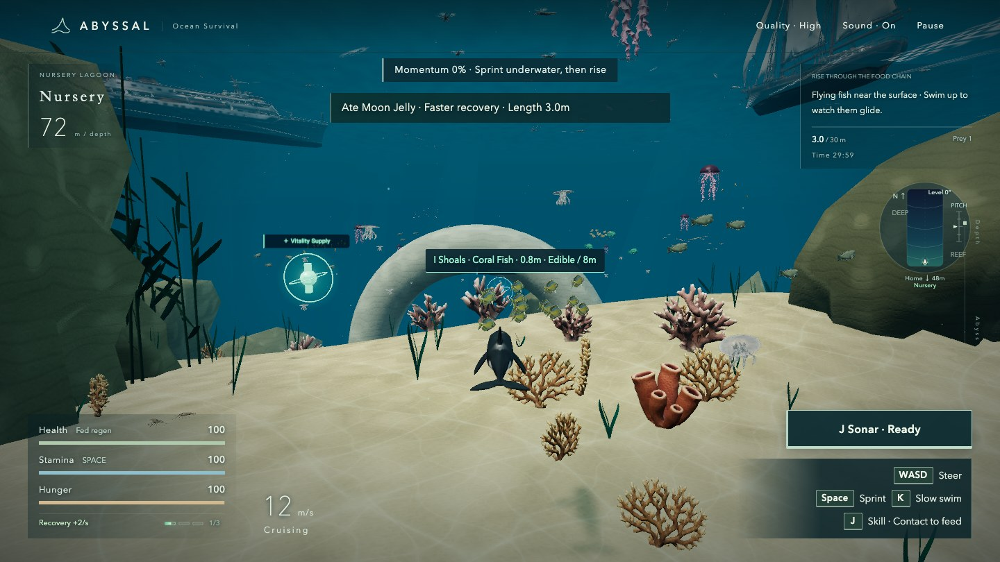
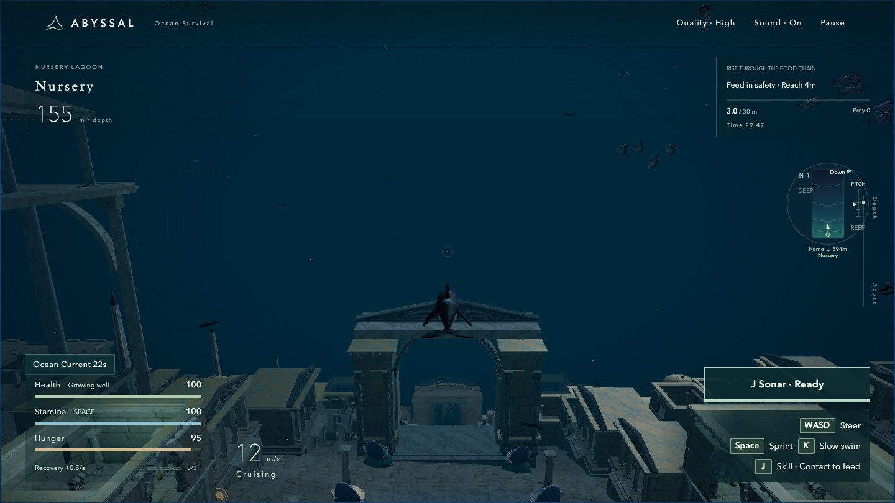
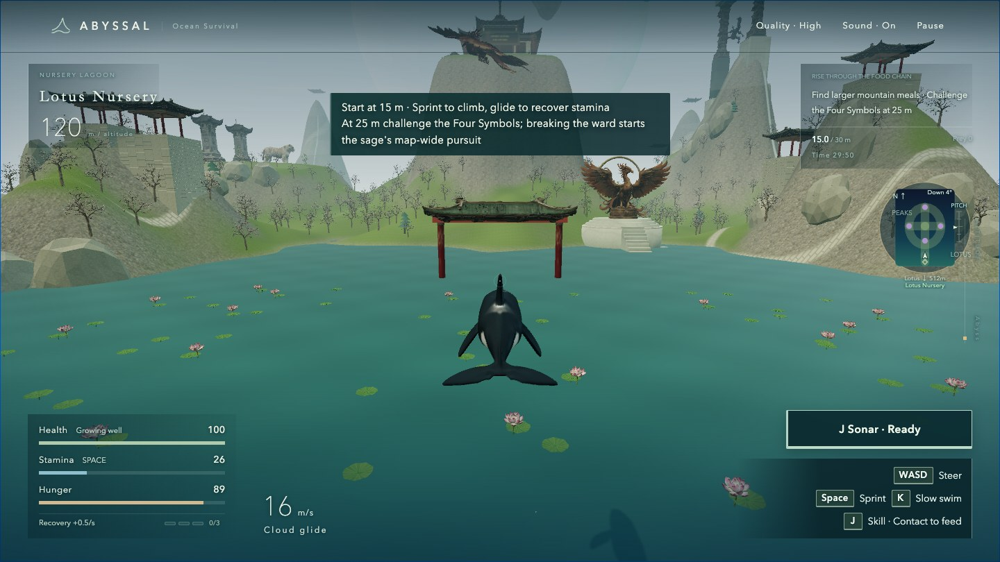

# ABYSSAL

[English](README.md) | **简体中文**

**[立即在浏览器中试玩 →](https://stanatny.github.io/abyssal/)** · 无需安装或注册账号

一款单人 3D 生存探索游戏。在八个世界中捕食、成长、躲避猎手并挑战巨兽，从阳光下的珊瑚礁，一路探索外星海洋与神话云海。

[](https://stanatny.github.io/abyssal/)

## 开始游玩

1. 使用支持 WebGL2 的现代浏览器 **[打开游戏](https://stanatny.github.io/abyssal/)**。
2. 选择角色与目的地，点击**开启远征**。初次游玩可以从夏威夷海域开始。
3. 捕食更小的生物，避开更大的猎手，并按界面中的目标推进。在首页打开**海洋图鉴**，了解生物、技能与地标。

支持电脑键盘与手机触控。可在首页选择英语或简体中文。设备需要减轻渲染负担时，可将画质切换为**流畅**。

## 探索八个世界

| 目的地             | 远征内容                                                           |
| ------------------ | ------------------------------------------------------------------ |
| **夏威夷海域**     | 从珊瑚礁间的幼年状态逐步成长，再挑战深渊领主。                     |
| **亚特兰蒂斯遗迹** | 寻找隐藏钥匙，破解随机抽取的环境机关，击败真正的守宝者并开启宝箱。 |
| **百慕大三角**     | 探索风暴海域与沉船，击败全部四位领主。                             |
| **马里亚纳海沟**   | 从 15 米起步，依次击败四位守关领主，抵达海沟底部。                 |
| **亚马逊河**       | 沿雨林河道捕猎，战胜三位河道领主。                                 |
| **木卫二冰下海洋** | 探索冰壳下的外星海洋，迎战三位领主。                               |
| **蓬莱仙境**       | 在神话山水间游泳、飞行，挑战四象神兽与御剑真君。                   |
| **奥德赛迷航海域** | 探索希腊神话风格的海域，击败三位守卫。                             |

| 亚特兰蒂斯遗迹                                                                                                            | 蓬莱仙境                                                                                                               |
| ------------------------------------------------------------------------------------------------------------------------- | ---------------------------------------------------------------------------------------------------------------------- |
| [](https://stanatny.github.io/abyssal/) | [](https://stanatny.github.io/abyssal/) |

_以上为 v0.11.28 英文界面实机截图。_

## 选择角色

- **虎鲸** — 利用回声定位与高速冲刺捕猎、探索。
- **大王乌贼** — 喷墨脱身，灵活转向。
- **丧尸鲨鱼** — 召唤并指挥尸鲨仆从。
- **机械鲨鱼** — 装甲护身，瞄准后发射追踪鱼雷。

## 操作方式

角色会持续向前游动。接触符合条件的目标后会自动捕食或攻击，无需按键咬击。

| 操作                  | 键盘           | 触控         |
| --------------------- | -------------- | ------------ |
| 上浮 / 下潜与左右转向 | W / S 与 A / D | 左侧摇杆     |
| 冲刺                  | 按住空格       | 按住冲刺按钮 |
| 慢游                  | 按住 K         | 按住慢游按钮 |
| 主动技能              | J              | 技能按钮     |
| 暂停 / 继续           | Esc 或 P       | 暂停按钮     |

鼠标用于操作菜单和图鉴。可在远征设置中反转上下控制。偏好设置与通关记录保存在当前浏览器中；未结束的对局不会存档。

## 本地运行

使用 JavaScript、Three.js 与 Vite 开发。需要 Node.js 22.12 或更新版本。

```bash
git clone https://github.com/stanatny/abyssal.git
cd abyssal
npm ci
npm run dev
```

打开 Vite 输出的本地地址。检查与生产构建命令：

```bash
npm test
npm run check
npm run build
```

## 项目资料

- [当前版本 — v0.11.29](docs/release_v0_11_29.md)
- [开发规则](AGENTS.md) · [资产质量标准](docs/asset_quality_standard.md)
- [本地化](docs/localization.md) · [音频来源](docs/audio_sources.md) · [验证记录](docs/verification.md)
- [此前的完整 README 与开发历史](https://github.com/stanatny/abyssal/blob/ef6a6a2345329370d553a87d97389b869ac22cfe/README.md)

各个世界融合了现实动物、灭绝物种与幻想生物。体型和生态为玩法服务，并非科学模拟。
